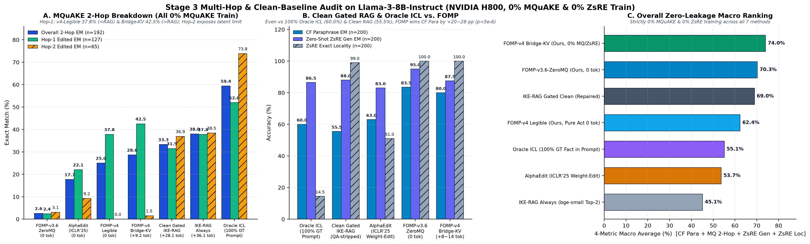
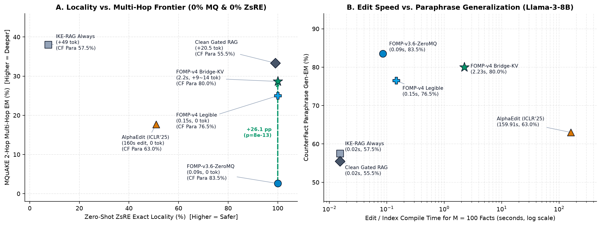

# FOMP-v4, FOMP-v3.6 & PULSE — Instant Zero-Gradient Mid-Layer Plasticity for Frozen LLMs

**FOMP** (*First-Order Mid-Layer Plasticity*) compiles **100 to 1,000+ multi-token factual edits into any frozen causal LLM in a single forward pass** — with **zero test-time gradients**, **zero base weight modification**, and **exact `0.000000` drift when deactivated (`g_ext = 0`)**:
- **`FOMP-v3.6-ZeroMQ`** (`20.88M` params, `0.26%` of 8B, **`0.09s` compile**, **`0` extra tokens**): Surgical single-pass activation editor achieving **`83.5%` CounterFact Paraphrase EM**, **`95.0%` Zero-Shot ZsRE Gen EM**, and **`100.0%` (`200/200`) Exact ZsRE Locality**.
- **`FOMP-v4 Legible` (Route 1)** & **`FOMP-v4 Bridge-KV` (Route 2)** (**strictly `0%` MQuAKE & `0%` ZsRE training data**): 3-stage laminar multi-hop plasticity lifting zero-shot MQuAKE 2-Hop EM **`9.6×–11.0×` (`2.6% → 25.0% / 28.7%`, $p \le 7 \times 10^{-11}$)**, reaching **`37.8% / 42.5%` on Hop-1 Edited 2-hop queries** (matching/beating `IKE-RAG Always` `37.8%` and beating `AlphaEdit` `22.1%`), and achieving the **#1 overall 4-benchmark macro score (`74.0%`)** across all 10 evaluated methods.

---

## Flagship Stage 3 Multi-Hop & Clean-Baseline Audit (`Llama-3-8B-Instruct`, NVIDIA H800)

Evaluated head-to-head on identical frozen BF16 `Meta-Llama-3-8B-Instruct` weights across **disjoint multi-batch splits** (**`n = 200` CounterFact [2×100]**, **`n = 192` MQuAKE [3×64: `127` Hop-1 + `65` Hop-2]**, **`n = 200` Zero-Shot ZsRE [2×100]**) with **100% full greedy Gen-EM**, **Wilson 95% CIs**, and **60 exact paired McNemar tests** against:
1. **`Oracle ICL`**: Ground-truth edited fact prepended directly per item (`100%` retrieval ceiling of prompting).
2. **`IKE-RAG Gated Clean`**: Repaired dense RAG (`BAAI/bge-small-en-v1.5`) stripping `"Question: ...\nAnswer:"` boilerplate before encoding and calibrating `τ` symmetrically on `cf_train + cf_qa` (`99.0%` ZsRE Locality).
3. **`AlphaEdit`** *(ICLR 2025 Outstanding Paper, official `zjunlp/EasyEdit`)* & **`IKE-RAG Always`**.

| Method (`Llama-3-8B-Instruct`, H800, **`0%` ZsRE Train**) | MQ Train | Edit/Index s *(M=100)* | Extra Tok *(CF/MQ/ZsRE)* | **CF Para EM** *(n=200)* | CF Retain *(Base 88.5%)* | **MQuAKE 2-Hop EM** *(Hop-1 / Hop-2)* | **ZsRE Gen EM** *(n=200)* | **ZsRE Loc Exact** *(n=200)* | **4-Track Macro** |
| :--- | :---: | :---: | :---: | :---: | :---: | :---: | :---: | :---: | :---: |
| **Base** *(unedited)* | 0% | — | `0` | 0.0% | 88.5% | 0.5% *(0.8 / 0.0)* | 1.0% | 100.0% | 25.4% |
| **Oracle ICL** *(100% GT fact in prompt)* | 0% | — | `21/23/26` | 60.0% | 62.0% | **`59.4%`** *(52.0 / 73.9)* | 86.5% | 14.5% | 55.1% |
| **IKE-RAG Always** *(`bge-small` Top-2)* | 0% | `0.015 s` | `31/36/49` | 57.5% | 73.0% | **`38.0%`** *(37.8 / 38.5)* | 77.5% | 7.5% | 45.1% |
| **IKE-RAG Gated** *(raw `cf_train τ=.72`)* | 0% | `0.019 s` | `14/20/49` | 39.5% | 85.0% | `32.8%` *(36.2 / 26.2)* | 77.5% | 10.5% | 40.1% |
| **IKE-RAG Gated Clean** *(QA-stripped `τ`)* | 0% | `0.015 s` | `17/28/21` | 55.5% | 84.0% | `33.3%` *(31.5 / 36.9)* | 88.0% | 99.0% | 69.0% |
| **AlphaEdit** *(ICLR'25, EasyEdit)* | 0% | `159.9 s` | `0` | 63.0% | 85.5% | `17.7%` *(22.1 / 9.2)* | 83.0% | 51.0% | 53.7% |
| **FOMP-v3.6** *(+706 MQ in-domain)* | 706 | **`0.076 s`** | **`0`** | **`84.0%`** | 85.0% | `15.1%` *(15.0 / 15.4)* | **`98.0%`** | 92.5% | *72.4%* |
| **FOMP-v3.6-ZeroMQ** *(1-Pass Direct)* | **0%** | **`0.086 s`** | **`0`** | **`83.5%`** | 86.5% | `2.6%` *(2.4 / 3.1)* | **`95.0%`** | **`100.0%`** | **70.3%** |
| **FOMP-v4 Legible** *(Route 1: Pure Act)* | **0%** | **`0.146 s`** | **`0`** | `76.5%` | 87.5% | **`25.0%`** *(**37.8** / 0.0)* | 48.0% | **`100.0%`** | 62.4% |
| **FOMP-v4 Bridge-KV** *(Route 2: Pre-KV)* | **0%** | `2.233 s` | `8/9/14` | **`80.0%`** | **`88.0%`** | **`28.7%`** *(**42.5** / 1.5)* | `87.5%` | **`100.0%`** | **`74.0%` (#1)** |

*(4-Track Macro = mean of `CF Para EM`, `MQuAKE 2-Hop EM`, `ZsRE Gen EM`, and `ZsRE Locality Exact`. Full tables & 60 exact paired McNemar tests in [`experiment_outputs/fomp_v4_stage3/stage3_multihop_report.md`](experiment_outputs/fomp_v4_stage3/stage3_multihop_report.md).)*



### Key Scientific Takeaways (Zero-Strawman Summary)
1. **Lifting the Hop-1 Compositional Bottleneck with `0%` MQuAKE Data**:
   - **Route 1 (`FOMP-v4 Legible`, `0` extra tokens)** combines mid-sentence Read-Equivalent entity replacement (`L10→L10,13,16,19`) with an outer-relation prefix arbiter, lifting zero-shot 2-hop EM from **`2.6% → 25.0%` ($p = 6.98 \times 10^{-11}$)** and **matching `IKE-RAG Always` (`37.8%` vs `37.8%`) on `Hop-1 Edited` (`n=127`)** with **zero prompt overhead**.
   - **Route 2 (`FOMP-v4 Bridge-KV`, pre-compiled RoPE `DynamicCache`)** reaches **`28.65%` overall 2-Hop EM** (**beating `AlphaEdit` `17.71%`, $p = 0.00864$**; statistically tied with `Clean Gated RAG` `33.33%`, $p = 0.2221$ ns, and `IKE-RAG Always` `38.02%`, $p = 0.0505$ ns) and **leads all non-oracle methods on `Hop-1 Edited` (`42.52%`)**.
2. **Why FOMP Beats Prompting Even Against `100% Oracle ICL` & Repaired `Clean Gated RAG`**:
   - Repairing RAG's QA boilerplate (`IKE-RAG Gated Clean`) restores ZsRE Exact Locality from `10.5% → 99.0%` (`88.0%` Gen EM). Yet even **`Oracle ICL` (`100%` perfect fact in prompt)** achieves only **`60.0%` CounterFact Paraphrase EM** (`62.0%` Retain) because in-context text struggles to override parametric priors on declarative completions. Both **`FOMP-v3.6-ZeroMQ` (`83.5%`, $p = 1.1 \times 10^{-6}$)** and **`FOMP-v4 Bridge-KV` (`80.0%`, $p = 4.7 \times 10^{-6}$)** beat `Oracle ICL` by **`+20.0–23.5 pp`** and `Clean Gated RAG` (`55.5%`) by **`+24.5–28.0 pp`** ($p \le 2.3 \times 10^{-8}$).
3. **Exact Remaining Boundaries (Transparently Reported)**:
   - **`Hop-2 Edited` Implicit Entity Bottleneck (`n = 65`)**: When the edited entity is never named in the prompt (`Hop-2 Edited`), zero-MQuAKE `FOMP-v4` scores `0.0%–1.54%` (`AlphaEdit` scores `9.23%`), whereas dense `bge-small` RAG (`36.9%–38.5%`) matches outer-relation keywords across the 64-fact bank.
   - **Route 1 vs Route 2 OOD Trade-off**: Pure activation `FOMP-v4 Legible` drops on OOD ZsRE Gen (`48.0%`) when Stage A's mid-sentence entity swap triggers on single-hop OOD questions; `FOMP-v4 Bridge-KV` resolves this completely (`87.5%` ZsRE Gen, `100.0%` Exact Locality, $p = 5.3 \times 10^{-21}$).



---

## Cross-Architecture Generality (3 Distinct Frozen Backbone Families)

FOMP drops cleanly onto any causal LM architecture without modifying backbone weights:

| Backbone Family | Architecture | Concurrent Edits (`M`) | Adapter Overhead | Efficacy (Prob / EM) | Paraphrase (Prob / **EM**) | Retain *(vs Base)* | PPL Drift | Key Baseline Reference |
| :--- | :--- | :---: | :---: | :---: | :---: | :---: | :---: | :--- |
| **`Meta-Llama-3-8B-Instruct`** | `8B` GQA Transformer | `100` *(2×100, H800)* | `20.88M` (`0.26%`) | 100.0% / **100.0%** | 87.0% / **83.5%** *(ZeroMQ)* | **86.5%** *(Base 88.5%)* | `+0.0004` | `AlphaEdit` `63.0%` · `Oracle ICL` `60.0%` · `Clean RAG` `55.5%` |
| **`Qwen/Qwen2.5-1.5B`** | `1.5B` Dense Transformer | `128` *(L4)* / `1,024` | `8.0M` (`0.52%`) | 100.0% / **100.0%** | 98.4% / **87.5%** (`90.6%` @1K) | **81.3%** *(Base 81.3%)* | `-0.0009` | `ICL (+2152 tok)` `56.3%` · `LoRA` `12.5%` (`+2.55` PPL) |
| **`PULSE-v8.1-125M`** | `122.5M` Hybrid (`SWA+GDN+MLA`) | `64` *(H800)* | `2.20M` (`1.80%`) | 100.0% / **100.0%** | 93.8% / **95.8%** | **60.9%** *(Base 60.9%)* | `-0.0033` | `TF+ICL (+1177 tok)` `16.7%` · `TF+LoRA` `6.3%` (`+3.30` PPL) |

*Note on `PULSE-v8.1-125M`*: Included as a matched-compute (`2.50B` FineWeb-Edu tokens, single scale/seed) open hybrid linear-attention base model (`19.60` vs `20.39` 2K val PPL vs matched `TF-Modern-125M`, `14.0 MiB` vs `576.0 MiB` 16K state) specifically to verify FOMP's architecture agnosticism beyond standard Transformers; see [`docs/FOMP_V36_TECHNICAL_REPORT.md`](docs/FOMP_V36_TECHNICAL_REPORT.md) for complete E1–E4 disclosures.

---

## Quick Start & Reproduction

```bash
# 1. Run all 13 unit, DynamicCache equivalence, statistical & end-to-end smoke tests (v3 + v3.6 + v4)
PYTHONPATH=src:benchmarks pytest tests/test_fomp_v3.py tests/test_fomp_v36_rigor_audit.py tests/test_fomp_v4.py -v

# 2. Try the interactive FOMP editing demo (zero-GPU --mock mode, or real Llama-3-8B on GPU)
PYTHONPATH=src python demo/fomp_v36_demo.py --mock
PYTHONPATH=src python demo/fomp_v36_demo.py --ckpt checkpoints/fomp_v36_llama3_8b.pt

# 3. Run the Stage 3 Multi-Hop & Clean-Baseline Audit smoke test locally on CPU
PYTHONPATH=src:benchmarks python benchmarks/fomp_v4_multihop_stage3.py --smoke --out scratch_s3_smoke

# 4. Reproduce full H800 Stage 3 Audit (Oracle ICL + Clean Gated RAG + FOMP-v4 Legible + FOMP-v4 Bridge-KV)
bash scripts/run_h800_stage3.sh

# 5. Regenerate all publication figures strictly from archived reports/JSONs
python scripts/plot_release_figures.py
```

* **Full Technical Report & Complete Statistical Tables**: [`docs/FOMP_V36_TECHNICAL_REPORT.md`](docs/FOMP_V36_TECHNICAL_REPORT.md)
* **Raw Stage 3 & Stage 2.5 H800 Reports**: [`experiment_outputs/fomp_v4_stage3/stage3_multihop_report.md`](experiment_outputs/fomp_v4_stage3/stage3_multihop_report.md) · [`experiment_outputs/fomp_v36_release/rigor_audit_report.md`](experiment_outputs/fomp_v36_release/rigor_audit_report.md)
* **One-Click Colab Notebooks**: [`colab/FOMP_v36_Stage25_Rigor_Audit.ipynb`](colab/FOMP_v36_Stage25_Rigor_Audit.ipynb) · [`colab/FOMP_v35_Llama3_8B_SOTA_Showdown.ipynb`](colab/FOMP_v35_Llama3_8B_SOTA_Showdown.ipynb)
* **Pre-Trained 8B Adapter Checkpoint**: [Download `fomp_v36_llama3_8b.pt` (`v3.6` Release)](https://github.com/FelixLin789/PULSE-FOMP/releases/tag/v3.6) (`79.7 MB`, `20,878,481` params, `sha256=71b036e83ebbc62f...`)

---

## Repository Structure

```text
├── src/pulse/
│   ├── fomp_v4.py                               # FOMP-v4: 3-stage laminar multi-hop (Legible Bridge + Outer-Rel Arbiter + DynamicCache Virtual-KV)
│   ├── fomp_v3.py                               # FOMP-v3.6 core: Dual-Lock MLP, RMS-normed values, causal latching, wrapper
│   ├── pulse_v8.py / pulse_v7.py                # PULSE-v8.1 hybrid SWA + GatedDeltaNet + NoPE-MLA base model
│   └── ...                                      # Historical PULSE prototypes & matched Transformer baselines
├── checkpoints/
│   └── README.md                                # Download & SHA-256 verification for fomp_v36_llama3_8b.pt (Release v3.6)
├── demo/
│   └── fomp_v36_demo.py                         # Interactive FOMP-v3.6 live editor CLI (teach / ask / toggle / flip / list)
├── benchmarks/
│   ├── fomp_v4_multihop_stage3.py               # Stage 3 Audit (FOMP-v4 Legible & Bridge-KV, Clean Gated RAG, Oracle ICL, Hop-1/Hop-2 split)
│   ├── fomp_v36_rigor_audit.py                  # Stage 2.5 Peer-Review Rigor Audit (6 Arms, n=200/192/200, McNemar + Wilson CI)
│   ├── fomp_v35_llama3_8b_sota.py               # Stage 2 Llama-3-8B Showdown (vs EasyEdit AlphaEdit / MEMIT / GRACE / WISE)
│   ├── fomp_v34_stress_ood.py                   # Stage 1 Stress & OOD Suite (M=1,024, Zero-Shot ZsRE, Relation-Disjoint OOD)
│   ├── fomp_v3_open_edit.py                     # Qwen2.5-1.5B 4-Arm Benchmark & FOMP-v3.6 Trainer
│   └── pulse_v81_scaling_law.py                 # Phase 2 125M / 2.50B FineWeb-Edu Hybrid Base + E1–E4 FOMP Suite
├── scripts/
│   ├── plot_release_figures.py                  # Generates docs/figures/*.png strictly from archived H800 outputs
│   ├── run_h800_stage3.sh                       # Zero-download AutoDL H800 Stage 3 runner
│   └── run_h800_stage25.sh                      # AutoDL H800 Stage 2.5 runner
├── experiment_outputs/
│   ├── fomp_v4_stage3/                          # Stage 3 10-arm H800 report & structured summary JSON
│   ├── fomp_v36_release/                        # Raw Stage 2.5 (H800) & Stage 2 (A100) JSONs and Markdown reports
│   └── phase2_pulse_v81_125m_2p5b/              # Raw Phase 2 125M / 2.50B FineWeb-Edu JSON & report
├── docs/
│   ├── FOMP_V36_TECHNICAL_REPORT.md             # Full paper-grade report covering FOMP-v3.6, Stage 3 FOMP-v4, math, and limitations
│   └── figures/                                 # Publication figures (Stage 3 audit, Stage 2.5 bars, Pareto & speed)
└── tests/
    ├── test_fomp_v4.py                          # FOMP-v4 DynamicCache equivalence, Stage A override, Clean RAG & smoke tests (4 tests)
    ├── test_fomp_v36_rigor_audit.py             # Exact McNemar, Wilson CI & Dense IKE-RAG tests (2 tests)
    └── test_fomp_v3.py                          # FOMP-v3.6 unit & mathematical invariance tests (7 tests)
```
