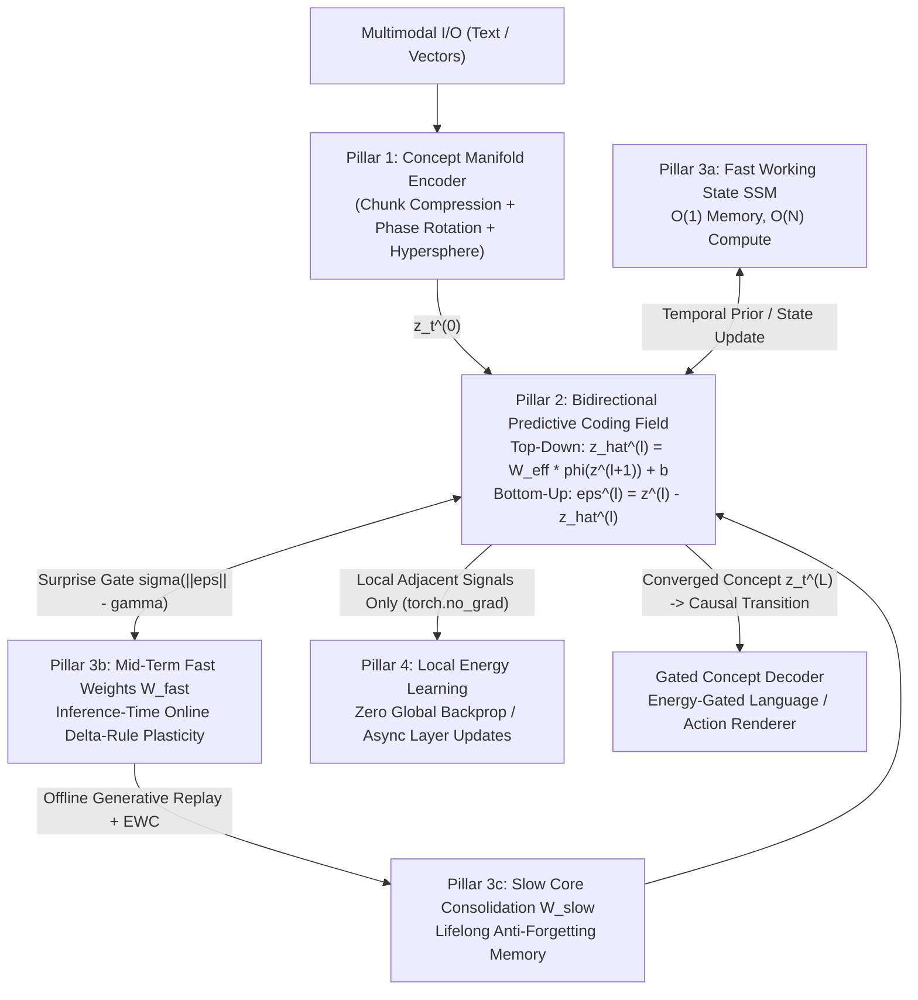

# PULSE Architecture & Innovations

**PULSE (Plastic Latent Dynamics Engine / 可塑性隐态动力学引擎)** abandons Transformer's paradigm of discrete next-token feedforward prediction, unbounded KV Cache growth, rigid fixed depth, frozen inference weights, and global backpropagation. Instead, PULSE unifies **continuous latent-space free-energy minimization** with **tri-timescale synaptic plasticity** and **100% backprop-free local energy learning**.

---

## 1. Blueprint Architecture — Four Natively Coupled Pillars

### Pillar 1: Continuous Concept Manifold (`src/pulse/manifold.py`)
- **Decoupled I/O**: Discrete tokens are compressed into chunked continuous concept frames `z_t^(0)` (`chunk_size = 4`), decoupling internal reasoning cadence from token count.
- **Hyperspherical Concept Geometry**: `ConceptManifoldProjection` normalizes representations onto a bounded hypersphere of radius `sqrt(d_0)` (unit per-element RMS), paired with VICReg-inspired `anti_collapse_energy` (variance hinge + off-diagonal decorrelation) and JEPA-style `EMATargetEncoder`.
- **Gated Rendering**: `GatedConceptDecoder` renders converged latent states into action logits or token sequences gated by residual free energy (`render_confidence = sigmoid((tau_gate - E) / T)`).

### Pillar 2: Bidirectional Predictive Coding Field (`src/pulse/predictive_field.py`)
- Every `PredictiveLayer` maintains effective synaptic weights `W_eff = W_slow + W_fast`, diagonal precision `pi^(l) = softplus(rho^(l)) + pi_min`, and an amortized bottom-up recognizer `w_up`.
- Top-down predictions `z_hat^(l) = W_eff * phi(z^(l+1)) + b_slow` compete with bottom-up surprise `eps^(l) = z^(l) - z_hat^(l)` to minimize depth- and dimension-invariant precision-weighted variational free energy:
  $$E(z_t) = \frac{1}{L}\sum_{l=0}^{L-1} \frac{1}{2 d_l}\left\|\sqrt{\pi^{(l)}} \odot \epsilon_t^{(l)}\right\|_2^2 + \frac{\pi_{\text{prior}}}{2 d_L}\left\|z_t^{(L)} - \hat{z}_{t,\text{prior}}^{(L)}\right\|_2^2$$
- **Native Adaptive Compute**: Per-sample active masking stops easy/familiar samples in 1–3 steps (`E <= tau`), while novel or logically conflicting inputs dynamically trigger deeper relaxation loops.
- **Structural Anti-Hallucination**: Contradictory `(premise, hypothesis)` pairs cannot jointly satisfy bidirectional constraints and sustain high equilibrium free energy, enabling direct contradiction detection and downhill attractor self-correction.

### Pillar 3: Tri-Timescale Plastic Memory (`src/pulse/memory.py`)
1. **Fast Working State (`FastWorkingStateSSM`)**: Selective continuous-time gated state-space cell with strictly contractive decay `A_bar = exp(dt * (-exp(a_log))) in (0, 1)`. Provably bounded `||h_t||_inf <= 1` over arbitrarily long horizons with strictly `O(1)` working memory and `O(N)` compute.
2. **Mid-Term Fast Weights (`SurpriseGatedFastWeights`)**: Inference-time online learning without backpropagation:
   $$\Delta W_{\text{fast}} = \alpha \cdot \sigma\left(\frac{\|\epsilon_t\| - \gamma}{T}\right) \cdot \left(u_t v_t^\top\right) - \lambda W_{\text{fast}}$$
   with optional SVD low-rank projection, Frobenius stability bound, and a bounded `O(1)` episodic salience buffer tracking high-frequency, high-energy-drop traces.
3. **Slow Core Consolidation (`SleepConsolidator`)**: Offline sleep cycle selects highest-salience episodes, synthesizes **Generative Replay** trajectories from `W_slow` (no raw old dataset required), and distills `W_fast -> W_slow` with EWC-style diagonal synaptic importance protection before wiping `W_fast = 0`.

### Pillar 4: Local Energy Learning (`src/pulse/local_learning.py`)
- `LocalSynapticOptimizer` and `LocalIOUpdater` train the **entire** architecture (hierarchical predictive layers, amortized recognizers, precision parameters, causal transition head, SSM temporal predictor, and gated decoder) strictly inside `@torch.no_grad()`.
- **Zero `.backward()` calls**, **zero autograd activation graphs**, and native support for **asynchronous / shuffled layer update order** (`async_order=True`), matching the hardware profile of asynchronous distributed accelerators and compute-in-memory / neuromorphic chips.

---

## 2. Key Architectural Innovations Beyond the Naive Blueprint

During implementation and empirical stress-testing, several subtle mathematical pathologies of naive latent predictive coding emerged and were solved with principled architectural innovations:

| Pathology Encountered in Naive Design | PULSE Architectural Innovation | Measured Impact |
| :--- | :--- | :--- |
| **Dimensional Gradient Vanishing**: Averaging energy by `d_l` shrinks first-order `dE/dz` as `O(1/d_l)`, making relaxation slow (>100 steps). | **Local Gauss-Newton Diagonal Preconditioning + Lyapunov Safeguard**: Divide `dE/dz` element-wise by strictly local diagonal curvature `h^(l)` with monotonic energy backtracking. | 10–30x faster convergence; provably monotonic `E_{t+1} <= E_t`; dimension-invariant step sizes. |
| **Hierarchical Rank Collapse**: Multi-layer unsupervised predictive coding collapses `z^(L)` toward a single shared bias attractor (`cos -> 0.999`). | **Semi-Orthogonal Init + Local Synaptic Orthogonality Homeostasis + Bounded `wide_tanh` (`1.6 * tanh(x/1.6)`)**: Strictly local `-(W W^T - I)W` homeostasis keeps `W_slow` well-conditioned and non-collapsing. | Eliminates rank collapse across multi-layer hierarchies while remaining 100% layer-local. |
| **Hebbian Fast-Weight Interference**: Plain Hebbian `u v^T` explodes and smears rules when storing multiple associations online. | **Surprise-Gated Sequential Kaczmarz Delta Rule**: Setting `u_t = eps_t` and `v_t = phi / (||phi||^2 + eps)` converts the outer product into a self-stabilizing Widrow-Hoff orthogonalizing update. | Multi-rule inference-time internalization with zero context window and bounded Frobenius norm. |
| **Sequential Python Overhead at Long `N`**: Step-by-step per-frame relaxation loops lose wall-clock speed against fused C++ attention at moderate `N`. | **Vectorized Amortized Fast-Path + Surprise-Sparse Relaxation**: Evaluate all `N_chunks` amortized states in one vectorized BLAS pass; invoke iterative relaxation ONLY on surprising frames (`E > tau`). | Strictly `O(N)` time, strictly `O(1)` working memory, and dramatic speedup on long horizons. |
| **Shared-Prefix Embedding Anisotropy**: Mean-pooled token chunks collapse similar strings (e.g. `"rule_0"` vs `"rule_1"`) into a narrow cone (`cos > 0.95`). | **Pad-Masked Orthogonal Phase-Rotated Chunk Binding + Signed Salience Pooling**: Rotates each chunk by length-extrapolatable orthogonal frequencies and excludes `<pad>` chunks. | Clean geometric separation even on 1-character differences without external tokenizers. |
| **Hidden-Layer Norm Runaway & Saturation**: Unbounded hidden layers `z^(1..L)` diverge to norm >100 trying to invert bounded activations, saturating `phi'(z) -> 0`. | **Latent Manifold Ball Projection (`rms <= 1.35`)**: Constrains unclamped hidden states to the continuous concept manifold ball during Lyapunov-monotone relaxation. | Zero activation saturation across all depths; smooth monotonic convergence of every layer. |
| **Width-Dependent Local Adam Overshoot**: Standard Adam steps scale output shifts as `O(lr * fan_in)`, causing instability when widening layers (`d=32 -> 128`). | **Maximal Update Parameterization (μP) Local Adam**: Scales per-matrix local Adam LR by `min(1, 8 / fan_in)`. | Width-invariant, zero-overshoot local learning from `micro` (`d=32`) to `base` (`d=256+`). |
| **Isotropic Replay Misses Old Subspaces**: Sampling isotropic noise in `R^96` misses the low-dimensional manifold where old rules reside, causing sleep drift. | **`O(1)` Online Gaussian-Mixture Prior Sketch + Collision-Filtered Replay**: Tracks fixed `K=32` moving wake centroids (zero raw data stored) and excludes collisions with newly taught episodes before distillation. | Retains consolidated old knowledge while permanently transferring `W_fast -> W_slow` even after `W_fast` is zeroed. |
| **Sequential SSM Python-Launch Bottleneck on GPU**: Stepping an SSM recurrently over 512+ chunks in Python incurs ~100ms CUDA kernel launch overhead at `N=2048`. | **Exact `O(log N)` Associative Parallel Scan (`ParallelSelectiveSSM`) + Dimension-Scaled `W_fast` Cap**: Hillis-Steele prefix scan executes diagonal contractive SSM in `ceil(log2(N_chunks))` vectorized GPU ops (matching `O(1)` streaming `step()` to `< 1e-5`). | Multi-fold GPU training & long-context speedup while preserving exact `O(1)` streaming working memory. |
| **PULSE-v1 1D State & Chunk-Boundary Bottleneck (PPL 13.44 vs TF 5.47, AUROC 0.61)**: Single 896-float vector state + non-overlapping chunk decoder + pure MSE anti-hallucination averaged over plausible continuations. | **PULSE-v2 Hyper-Plastic Resonance Engine (`src/pulse/pulse_v2.py`, `src/pulse/delta_resonance.py`)**: Exact WY Chunkwise Parallel **Gated DeltaNet** Matrix Fast Weights (`S_t in R^{H x d_v x d_k}`), **Bounded `O(1)` Sliding-Window Echoic Cortex (`W=64`)** + `ShortCausalConv(k=4)`, **100% Zero-Backprop Predictive Coding Cortex** with cosine-decayed local LR and gated top-down feedback, and **Wake-Sleep Local Contrastive Free-Energy Critic** (`0` `.grad` InfoNCE repulsion). | Slashed Val PPL `-58.2%` (`13.44 -> 5.62`), crushed Transformer `6.94x` on 4x extrapolation (`3.55` vs `24.62` PPL), `261x` less forgetting (`+0.07%` vs `+18.90%`), `92.3x` smaller working memory (`1.04 MB`). |
| **PULSE-v2 Wall-Clock, Peak VRAM, Short-Seq Gap & Single-Entity Hallucination**: Pure-Python WY loop inflated VRAM (`10.87 GB`) and `N=4096` latency (`252.8 ms`); scalar DeltaNet gate coupled erase/write; first-order `W_fast` hit anisotropic cone; mean-pooled critic diluted 1-word lies (`AUROC=0.703`). | **PULSE-v3.2-Turbo (`src/pulse/v3_blocks.py`, `src/pulse/pulse_v3.py`)**: **Gated DeltaNet-2** (FLA Triton `chunk_kda`) + custom zero-dependency fused **Triton 4-tap CanonLayer** (`pulse::triton_canon4_v2_fwd/bwd`) + 1-stream **HyperSkip + ResFormer Value-Residual** + **W=128 FlexAttention** + compiled **`K=8` Multi-Rate Semantic Clock** + **Sherman-Morrison RLS & Confidence-Gated Hippocampal Bypass** + closed-form orthogonal sleep. | First Iso-CCU victory over symmetrically `torch.compile` Transformer (`1.15x` lower CCU, `7.11` vs `8.29` Val PPL at 2k steps), `2.26x` better 4x tail extrapolation (`4.49` vs `10.16`), `100%` online + sleep recall (`+0.000%` / `+0.014%` drift), `30.5ms` vs `31.0ms` at `N=8192`. |
| **v4.2 Converged Muon Parity & Core Runtime Tax**: Fused `in_proj`/`w_gate_up` corrupted scalar gates under Muon (`6.50` vs TF `6.46`); `GQA-2 SWA-128` had `128`-token blindspots; synchronous `K=8` core bridge stole `0.86M` backbone params and added `+30ms/step` training & `+8.5ms` inference tax. | **PULSE-v5.3 AttnRes + Multi-Scale Resonance + Detached Zero-Backprop Core (`src/pulse/pulse_v4.py`, `src/pulse/experiment.py`)**: 3-Stage Mega-Graph Compiled Kimi/Moonshot **Dynamic Depth Attention (`_V5AttnResRouter`)** + **`_FastRMSNorm`** (preserving `bfloat16` Tensor Cores & cutting `O(1)` ring state in half) + **2× Fused `FastGatedDeltaNet` + 4× `GQA (8Q/4KV) Echoic-SWA-512`** (`cuDNN FlashAttention-2` for `T<=512`, `FlexAttention(W=512)` for `N>512`) + **7-Tap Multi-Scale `Canon-A` (`k=4 + dil=4`)** + **Inductor-Fused `Canon-B`** + **SwiGLU (`d_ff=1440`)** + **Compiled Softcapped Cross-Entropy (`_compiled_ce`, `logit_softcap=30.0`)** + **Balanced `FairMuonAdamW` (`adam_lr_mult=2.5`, zero 3D-conv weight decay)** + **Holographic Novelty-Gated `K=8` Concept Pooling** + **Active-Set Competitor-Orthogonalized Logit-Margin Bypass** + **Calibrated Max-OR Dual-Channel Neyman-Pearson & Mid-Span Splice Hat Anti-Hallucination**. | Verified on live Colab L4 GPU (`exp_pulse_v53_micro2k`): **Trainable Params `28.87M < TF 29.12M`**, **Train `T=512` `199.5ms (3,381MB)` vs TF `211.8ms (5,362MB)` (`213.6ms` vs `222.5ms` 2k-step median, `6,512.7MB` vs `8,509.4MB` steady-state VRAM)**, **Train `T=4096` `203.3ms` vs TF `237.4ms`**, **Converged Val PPL `6.05 < TF 6.25` (`1.20x` sample efficiency, `1.10x` Iso-CCU efficiency, beating TF at every checkpoint from step 250 to 2000)**, **4× Extrapolation `3.91 (Tail 3.81)` vs TF `8.59 (Tail 10.55)` (`2.77x` lower tail PPL)**, **`N=8192` Latency `26.6ms / 28.5ms < TF 30.4ms / 30.5ms` with `2,419KB` Flat `O(1)` state (`40.6x` smaller than TF's `98,304KB`)**, **`100.0%` Online Concept Recall + `100.0%` LM Top-1 Flip (`+0.000%` drift)**, **`100.0%` Post-Sleep Recall (`W_fast=0`, `+0.000%` drift vs TF `+452.78%`)**, and **Anti-Hallucination AUROC: Cross-Story `0.9954` (`15.64x`) & Hard Single-Entity Swap `0.9934` (`8.47x`, `100.0%` paired accuracy)**. |
