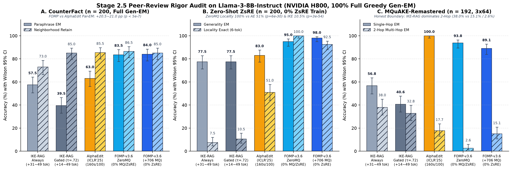
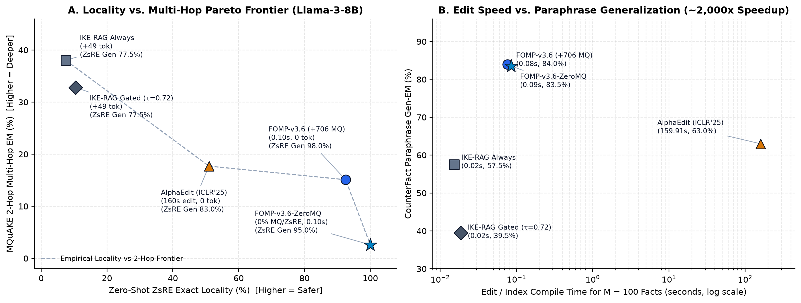

# FOMP-v3.6 Technical Report: First-Order Mid-Layer Plasticity for Instant, Zero-Gradient Knowledge Editing in Frozen LLMs

> **Summary**: **FOMP-v3.6** (*First-Order Mid-Layer Plasticity*) is a lightweight (`20.88M` parameters, **`0.26%`** of an 8B model), architecture-agnostic mid-layer plasticity adapter that compiles **100 to 1,000+ multi-token factual edits into any frozen causal LM in a single forward pass (`0.08–0.10s` per 100 edits on H800, `1.30s` for 1,000 edits on A100 — zero test-time gradients, zero base weight modification, zero extra prompt tokens, and exact `0.000000` drift at `g_ext = 0`)**.
>
> In our high-power **Stage 2.5 Peer-Review Rigor Audit** on `Meta-Llama-3-8B-Instruct` (`NVIDIA H800`, `n = 200` CounterFact, `n = 192` MQuAKE, `n = 200` Zero-Shot ZsRE, **100% full greedy Gen-EM**, Wilson 95% CIs, and exact paired McNemar tests) against both **official `AlphaEdit` (ICLR 2025 Outstanding Paper)** and same-paradigm **Dense Retrieval `IKE-RAG` (`BAAI/bge-small-en-v1.5`, Always & Train-Calibrated Gated)**:
> - **Where FOMP-v3.6 decisively dominates**: Even in the **strictly zero-MQuAKE / zero-ZsRE** variant (`FOMP-v3.6-ZeroMQ`), FOMP compiles **`1,655×–1,868×` faster** than `AlphaEdit` while achieving **`83.5%` CounterFact Paraphrase EM** (`+20.5 pp` vs `AlphaEdit` `63.0%`, `p = 2.79e-7`; `+26.0 pp` vs `IKE-RAG Always` `57.5%`, `p = 3.13e-8`; `+44.0 pp` vs `IKE-RAG Gated` `39.5%`, `p = 4.77e-18`), **`95.0%` Zero-Shot ZsRE Generality EM** (`+12.0 pp` vs `AlphaEdit`, `p = 6.96e-5`; `+17.5 pp` vs `IKE-RAG`, `p = 3.63e-7`), and **`100.0%` (`200/200`) Exact ZsRE Locality** (`+49.0 pp` vs `AlphaEdit` `51.0%`, `p = 6.31e-30`; `+89.5 pp` vs `IKE-RAG Gated` `10.5%`, `p = 2.61e-54`), with **`+0.0004`** WikiText-2 PPL drift.
> - **Exact scientific boundary (zero spin)**: On `n = 192` **MQuAKE 2-Hop Multi-Hop Reasoning**, explicit context-injection **`IKE-RAG`** decisively wins (`38.02%` Always / `32.81%` Gated), `AlphaEdit` reaches `17.71%` (`100%` 1-Hop), in-domain `FOMP-v3.6 (+706 MQ)` ties `AlphaEdit` (`15.10%`, `p = 0.5831`), and zero-shot `FOMP-v3.6-ZeroMQ` achieves only `2.60%` (`p = 3.03e-6`). Single-pass mid-layer activation editing is an ultra-fast, zero-prompt-tax, surgical single-hop & paraphrase editor — **not** a substitute for multi-step in-context reasoning.
> - **Cross-architecture generality**: Verified across **3 distinct frozen backbone families**: `Meta-Llama-3-8B-Instruct` (`8B` GQA Transformer), `Qwen/Qwen2.5-1.5B` (`1.5B` Dense Transformer), and `PULSE-v8.1-125M` (`122.5M` matched-compute Hybrid `SWA + GatedDeltaNet + NoPE-MLA` base model).

---

## 1. Motivation & Paradigm Positioning

Existing LLM knowledge editors occupy distinct corners of a four-way trade-off across edit latency, prompt overhead, paraphrase generalization, locality under format shift, and compositional multi-hop reasoning:

| Paradigm | Representative Methods | Edit/Index Time (`M=100`, 8B H800) | Extra Prompt Tok | CF Para EM (`n=200`) | Zero-Shot ZsRE Gen / **Loc** (`n=200`) | MQuAKE 2-Hop EM (`n=192`) | Base Weights Modified? |
| :--- | :--- | :---: | :---: | :---: | :---: | :---: | :---: |
| **Prompt Retrieval** | `IKE-RAG Always` (`bge-small`) | **`0.015 s`** | `+31~49` | 57.5% | 77.5% / **7.5%** | **`38.02%`** | No |
| **Gated Prompt RAG** | `IKE-RAG Gated` (`cf_train τ=0.72`) | **`0.019 s`** | `+14~49` | 39.5% | 77.5% / **10.5%** | `32.81%` | No |
| **Locate-and-Edit** | `AlphaEdit` *(ICLR'25, EasyEdit)* | `159.9 s` *(+nullspace `P`)* | **`0.0`** | 63.0% | 83.0% / **51.0%** | `17.71%` | Yes (MLP weights) |
| **Codebook Adapter** | `GRACE` *(EasyEdit, A100)* | `255.3 s` | **`0.0`** | 0.0% | 1.6% / **100.0%** | 3.12% *(n=32)* | No (adapter) |
| **FOMP-v3.6-ZeroMQ** | **Single-Pass Fast Weights (`0%` MQ/ZsRE)** | **`0.086 s`** *(1,868× vs AE)* | **`0.0`** | **`83.5%`** | `95.0%` / **`100.0%`** | `2.60%` | **No (100% frozen)** |
| **FOMP-v3.6 (+MQ)** | **Single-Pass Fast Weights (`0%` ZsRE)** | **`0.076 s`** *(2,101× vs AE)* | **`0.0`** | **`84.0%`** | **`98.0%`** / `92.5%` | `15.10%` | **No (100% frozen)** |

**FOMP-v3.6** separates **amortized offline routing/injection calibration** (trained once per frozen backbone family in ~6 min on 1× H800 using strictly entity-disjoint training splits, **0% ZsRE**) from **instant online 1st-order memory compilation** at deployment time (a single forward pass through layers `0 .. L_read - 1`, zero backprop, `0` extra prompt tokens).

---

## 2. Architecture (`src/pulse/fomp_v3.py`)

Given any frozen causal decoder LM with hidden size $d$ and $L$ layers (e.g. `Llama-3-8B-Instruct`: $d=4096, L=32, L_{\text{read}}=16$, injection layers $\{16, 19, 23, 27, 31\}$; `Qwen2.5-1.5B`: $d=1536, L=28, L_{\text{read}}=14$, injection layers $\{14, 17, 21, 24, 26\}$; `PULSE-v8.1-125M`: $d=768, L=12, L_{\text{read}}=6$, injection layers $\{6, 8, 9, 10, 11\}$):

### 2.1 Single-Pass Episode Compilation (`compile_token_episodes`)
For $M$ arbitrary natural-language edits $\{(c_m, y_m)\}_{m=1}^M$ where each target phrase $y_m = (y_{m,0}, \dots, y_{m,K_m-1})$ has variable length $1 \le K_m \le K_v$ ($K_v=8$):
1. **Early-State Encoding**: Run frozen backbone layers $0 \dots L_{\text{read}}-1$ once (chunked in slices of 128 for $O(1)$ peak VRAM at $M=1,024+$) to extract cue end states $h_m$, causal local-window mean $\bar{h}_m$ ($W_c=12$), tail window $H_m \in \mathbb{R}^{W_e \times d}$ ($W_e=18$), standalone target hidden states $h^{(y)}_{m,k}$, and exact output unembedding rows $e_{m,k} = W_{\text{lm\_head}}[y_{m,k}] \in \mathbb{R}^d$.
2. **Dual-Lock Keys**:
   - **Lock 1 (Relation + Context Key)**: $k^{\text{rel}}_m = \text{L2Norm}\big(z + W_{k2}\,\text{SiLU}(z)\big)$, where $z = W_{k1}[\text{RMSNorm}(h_m);\, \text{RMSNorm}(\bar{h}_m)] \in \mathbb{R}^{d_k}$.
   - **Lock 2 (Salience-Pooled Entity + Latent Bridge Key)**: Compute exact log-sum-exp causal salience weights $\alpha_{m,j} = \text{softmax}_j(w_s^\top \tilde{H}_{m,j})$ over the tail window to form $u^{\text{sal}}_m = \sum_j \alpha_{m,j}\tilde{H}_{m,j}$, then $k^{\text{ent}}_m = \text{L2Norm}\big(z_e + W_{e2}\,\text{SiLU}(z_e)\big)$ with $z_e = W_{e1}[u^{\text{sal}}_m;\, \text{RMSNorm}(h_m)] \in \mathbb{R}^{d_e}$.
3. **Dual-Path Normalized Value Bank**:
   - **Mid-Layer Semantic Bank** (unit-RMS normalized per slot for dimension invariance):
     $$v_{m,k} = \text{UnitRMS}\big(W_{\text{down}}\,\text{RMSNorm}(h^{(y)}_{m,k}) + p_k\big) \cdot \mathbb{1}[k < K_m] \in \mathbb{R}^{d_v}$$
   - **Zero-Shot Full-Rank Lexical Bank** (operates identically across all 128K–152K vocabulary tokens with zero low-rank bottleneck):
     $$\tilde{e}_{m,k} = \text{UnitRMS}(e_{m,k}) \odot \gamma_{\text{emb}} \cdot \mathbb{1}[k < K_m] \in \mathbb{R}^d$$
   - **Exact Zero-Edit Guarantee**: If $g_{\text{ext}} = 0$, hooks bypass completely and logits are bit-for-bit identical (`0.000000` drift).

### 2.2 Dual-Lock Factorized Routing & Multi-Token Causal Latching (`route_and_latch`)
At inference time on any sequence $h_{1:T}$ entering $L_{\text{read}}$:
1. **Exact $O(T \cdot W_e)$ Causal Salience Pooling**: Uses `unfold` + exact per-window `softmax` (zero float32 cumulative-sum cancellation, verified to `<1e-5` equivalence against windowed pooling even under `40×` logit amplification).
2. **Factorized AND-Gate with Steep Hill Saturation** ($\kappa = 0.03$):
   $$H(s, \tau) = \frac{r^2 (1 + \kappa)}{r^2 + \kappa}, \quad r = \frac{\max(0, s - \tau)}{1 - \tau}, \qquad g^{\text{all}}_{t,m} = H(s^{\text{rel}}_{t,m}, \tau_{\text{rel}}) \cdot H(s^{\text{ent}}_{t,m}, \tau_{\text{ent}})$$
   If **either** the relation lock **or** the entity lock fails to clear its learned threshold ($\tau_{\text{rel}} \ge 0.40$, $\tau_{\text{ent}} \ge 0.32$), $g^{\text{all}}_{t,m} = 0$ strictly.
3. **Anti-Slot-Theft Top-$K$ Selection ($K=2$)**: Candidates are ranked by $g^{\text{all}}_{t,m} + 10^{-3} s^{\text{joint}}_{t,m}$, guaranteeing a locked-out same-relation neighbor can never steal a Top-$K$ slot from a valid dual-lock match.
4. **Format-Invariant Similarity `direct_gate`**: Reads only the 2D lock similarity vector $[s^{\text{rel}}_{t,k} - 0.5,\; s^{\text{ent}}_{t,k} - 0.5]$ rather than raw last-token hidden state, preventing format overfitting on `\nAnswer:` suffixes.
5. **Vectorized Causal Lag-Shift Latching**: Position $t$ accumulates target slot `lag` from trigger position $t - \text{lag}$ for $\text{lag} \in \{0, \dots, K_v - 1\}$, masked by $\mathbb{1}[\text{lag} < K_{m^*}]$. Once all $K_{m^*}$ tokens are emitted, injection shuts off automatically.
6. **Dimension-Invariant Residual Injection (`compute_layer_delta`)**: At each injection layer $\ell$, `val_ups` is weight-RMS normalized so its output RMS stays strictly $O(1)$ across any backbone width ($d \in [64, 8192]$):
   $$\Delta h^{(\ell)}_t = \pm\, \text{rms}(h^{(\ell)}_t) \cdot \left(\text{softplus}(s^{(\ell)}_v)\, \frac{W^{(\ell)}_{\text{up}}\,\hat{v}_t}{\sqrt{d_v}\,\text{rms}(W^{(\ell)}_{\text{up}})} + \text{softplus}(s^{(\ell)}_e)\, \hat{e}_t\right)$$
   where the $\pm$ sign implements the **causal Sign-Flip verification switch** (`sign_flip=True` flips `+` to `-`).

### 2.3 Anti-Shortcut & Open-Vocab Generalization Training (`benchmarks/fomp_v3_open_edit.py`)
- **Zero Entity Overlap**: Strictly `0%` subject overlap between train and test splits; **`0%` ZsRE data** seen during training for all FOMP variants.
- **Zero-MQuAKE Ablation (`FOMP-v3.6-ZeroMQ`)**: Removes all 706 MQuAKE rows from training (`cf_train=3200 + cf_qa=800` only) to isolate strictly zero-shot multi-hop and zero-shot ZsRE generalization without any in-domain confound.
- **Format-Invariant Anti-Shortcut**: Wraps 800 `cf_train` cues/paraphrases/neighbors in `Question: ...?\nAnswer:` paired with same-format QA negatives + full $128 \times 128$ cross-negative margin penalty (eliminating the InfoNCE constant-shift loophole on shared `?\nAnswer:` suffixes).
- **Open-Vocab Multi-Token Target Swap + `val_path` Modality Dropout**: Slices 512 real 1–3 word English spans strictly from train WikiText-2 prose; on single-hop items, swaps the episode target with `40%` probability and drops `latched_v` with `50%` probability, forcing `e_bank` + lag-shift latching to generalize zero-shot across the full 128K vocabulary.
- **EMA Stabilization**: Exponential moving average (`decay = 0.985`) over the final 35% of steps.

---

## 3. Experimental Results (100% Raw-JSON Verified)

All raw outputs (including per-item binary hit vectors for every method and metric) are archived verbatim in [`experiment_outputs/fomp_v36_release/`](../experiment_outputs/fomp_v36_release/) and [`experiment_outputs/phase2_pulse_v81_125m_2p5b/`](../experiment_outputs/phase2_pulse_v81_125m_2p5b/).

### 3.1 Flagship Stage 2.5 Peer-Review Rigor Audit on `Meta-Llama-3-8B-Instruct` (`NVIDIA H800`)

Designed specifically to resolve three critical peer-review challenges: (1) adding strong same-paradigm retrieval baselines (**`IKE-RAG Always`** and train-calibrated **`IKE-RAG Gated`** using `BAAI/bge-small-en-v1.5`, `33.36M` params, `τ = 0.72` calibrated strictly on `cf_train` with 0% test leakage), (2) eliminating the MQuAKE in-distribution confound via **`FOMP-v3.6-ZeroMQ` (0% MQuAKE & 0% ZsRE train)**, and (3) scaling statistical power to disjoint batches (**`n = 200` CF [2×100]**, **`n = 192` MQuAKE [3×64]**, **`n = 200` ZsRE [2×100]**) with **100% full greedy Gen-EM**, **Wilson 95% CIs**, and **exact two-sided paired McNemar $p$-values**.



#### Table 1 — CounterFact (`n = 200`, 2 Disjoint Batches of `M=100`; Base WikiText-2 PPL = `9.3939`)

| Method (Paradigm) | Edit/Index s | Extra Prompt Tok | Efficacy EM | Paraphrase EM `[95% CI]` | Retain Prob `[95% CI]` | PPL Drift | Query ms |
| :--- | :---: | :---: | :---: | :---: | :---: | :---: | :---: |
| **Base** *(unedited)* | — | `0.0` | 0.5% | 0.0% `[0.0, 1.88]` | 88.5% `[83.34, 92.21]` | `+0.0000` | 70.94 ms |
| **IKE-RAG Always** *(`bge-small` Top-2)* | `0.0153 s` | `31.33` | 86.0% | 57.5% `[50.57, 64.15]` | 73.0% `[66.46, 78.68]` | `-0.0591` | 78.02 ms |
| **IKE-RAG Gated** *(`cf_train τ=0.72`)* | `0.0186 s` | `13.54` | 69.0% | 39.5% `[32.98, 46.41]` | 85.0% `[79.39, 89.29]` | `+0.0000` | 77.97 ms |
| **AlphaEdit** *(ICLR'25, EasyEdit)* | `159.91 s` | `0.0` | **100.0%** | 63.0% `[56.12, 69.39]` | 85.5% `[79.95, 89.71]` | `+0.0411` | **71.62 ms** |
| **FOMP-v3.6-ZeroMQ** *(`0%` MQ/ZsRE)* | **`0.0856 s`** | **`0.0`** | **100.0%** | **83.5%** `[77.73, 88.00]` | **86.5%** `[81.07, 90.55]` | **`+0.0004`** | 104.97 ms |
| **FOMP-v3.6** *(+706 MQ train)* | **`0.0761 s`** | **`0.0`** | **100.0%** | **84.0%** `[78.29, 88.43]` | 85.0% `[79.39, 89.29]` | `+0.0109` | 105.50 ms |

#### Table 2 — Zero-Shot ZsRE (`n = 200`, 2 Disjoint Batches of `M=100` — **`0%` ZsRE Training Data for ALL Methods!**)

| Method | Edit/Index s | Extra Prompt Tok | Reliability EM `[95% CI]` | **Generality EM `[95% CI]`** | **Locality Exact `[95% CI]`** *(Tok-Match)* |
| :--- | :---: | :---: | :---: | :---: | :---: |
| **Base** *(unedited)* | — | `0.0` | 1.5% `[0.51, 4.32]` | 1.0% `[0.27, 3.57]` | **100.0%** `[98.12, 100.0]` *(100.0%)* |
| **IKE-RAG Always** *(`bge-small` Top-2)* | `0.0181 s` | `49.36` | 78.5% `[72.30, 83.63]` | 77.5% `[71.23, 82.74]` | **7.5%** `[4.60, 12.00]` *(22.00%)* |
| **IKE-RAG Gated** *(`cf_train τ=0.72`)* | `0.0179 s` | `48.58` | 78.5% `[72.30, 83.63]` | 77.5% `[71.23, 82.74]` | **10.5%** `[6.97, 15.52]` *(24.09%)* |
| **AlphaEdit** *(ICLR'25, EasyEdit)* | `162.83 s` | `0.0` | 98.0% `[94.97, 99.22]` | 83.0% `[77.18, 87.57]` | **51.0%** `[44.12, 57.84]` *(63.33%)* |
| **FOMP-v3.6-ZeroMQ** *(`0%` MQ/ZsRE)* | **`0.0984 s`** | **`0.0`** | **99.5%** `[97.22, 99.91]` | **95.0%** `[91.04, 97.26]` | **100.0%** `[98.12, 100.0]` *(100.0%)* |
| **FOMP-v3.6** *(+706 MQ train)* | **`0.1033 s`** | **`0.0`** | 98.5% `[95.68, 99.49]` | **98.0%** `[94.97, 99.22]` | **92.5%** `[88.00, 95.40]` *(93.66%)* |

> **Mechanistic Discovery — Why Gated Dense RAG Collapses Under Format Shift While FOMP Holds `100.0%`**: Even though `IKE-RAG Gated`'s `τ = 0.72` threshold was calibrated strictly on CounterFact (`85.0%` CF Retain, `13.54` extra tokens), switching to ZsRE's `"Question: ...?\nAnswer:"` format lifts bi-encoder cosine scores of *unrelated* locality prompts above `τ = 0.72` (`48.58` extra tokens — misfiring on ~98% of locality queries, crashing exact locality to **`10.5%`**!). In contrast, `FOMP-v3.6-ZeroMQ`'s factorized Dual-Lock gate (trained with same-format QA negatives + $128\times128$ cross-negative margins) fires **0 times out of 200** on unrelated ZsRE prompts (**`100.0%` exact locality**) while hitting **`95.0%` zero-shot Generality EM** (`98.0%` for `FOMP-v3.6`).

#### Table 3 — MQuAKE-Remastered Multi-Hop (`n = 192`, 3 Disjoint Batches of `M=64` — Honest Boundary!)

| Method | MQuAKE Train? | Edit/Index s | Extra Prompt Tok | Single-Hop EM `[95% CI]` | **2-Hop Multi-Hop EM `[95% CI]`** |
| :--- | :---: | :---: | :---: | :---: | :---: |
| **Base** *(unedited)* | **0% (Zero-Shot)** | — | `0.0` | 0.0% `[0.0, 1.96]` | 0.52% `[0.09, 2.89]` |
| **IKE-RAG Always** *(`bge-small` Top-2)* | **0% (Zero-Shot)** | `0.0086 s` | `36.09` | 56.77% `[49.70, 63.58]` | **`38.02%`** `[31.45, 45.06]` |
| **IKE-RAG Gated** *(`cf_train τ=0.72`)* | **0% (Zero-Shot)** | `0.0086 s` | `19.89` | 40.62% `[33.93, 47.69]` | **`32.81%`** `[26.57, 39.73]` |
| **AlphaEdit** *(ICLR'25, EasyEdit)* | **0% (Zero-Shot)** | `104.38 s` | `0.0` | **`100.0%`** `[98.04, 100.0]` | `17.71%` `[12.96, 23.73]` |
| **FOMP-v3.6-ZeroMQ** *(`0%` MQ/ZsRE)* | **0% (Zero-Shot)** | **`0.0519 s`** | **`0.0`** | `93.75%` `[89.39, 96.39]` | `2.60%` `[1.12, 5.95]` |
| **FOMP-v3.6** *(+706 MQ train)* | 706 rows *(in-domain)* | **`0.0516 s`** | **`0.0`** | `89.06%` `[83.86, 92.73]` | `15.10%` `[10.73, 20.85]` |



#### Table 4 — Key Exact Paired McNemar Tests (Per-Item Aligned Binary Vectors, Two-Sided Exact Binomial)

| Comparison (`A` vs `B`) | Benchmark & Metric | `A` % | `B` % | Diff (pp) | `n10 / n01` | Exact McNemar `p` | Winner (`α = 0.05`) |
| :--- | :--- | :---: | :---: | :---: | :---: | :---: | :---: |
| `FOMP-ZeroMQ` vs `AlphaEdit` | CF Paraphrase EM (`n=200`) | 83.5% | 63.0% | **+20.50** | 53 / 12 | **`2.79e-07`** | **FOMP-ZeroMQ** |
| `FOMP-ZeroMQ` vs `AlphaEdit` | CF Retain Prob (`n=200`) | 86.5% | 85.5% | +1.00 | 6 / 4 | `0.7539` | Tie |
| `FOMP-ZeroMQ` vs `AlphaEdit` | ZsRE Generality EM (`n=200`) | 95.0% | 83.0% | **+12.00** | 30 / 6 | **`6.96e-05`** | **FOMP-ZeroMQ** |
| `FOMP-ZeroMQ` vs `AlphaEdit` | ZsRE Locality Exact (`n=200`) | 100.0% | 51.0% | **+49.00** | 98 / 0 | **`6.31e-30`** | **FOMP-ZeroMQ** |
| `FOMP-ZeroMQ` vs `AlphaEdit` | MQuAKE 2-Hop EM (`n=192`) | 2.60% | 17.71% | -15.10 | 1 / 30 | `2.98e-08` | **AlphaEdit** |
| `FOMP-ZeroMQ` vs `IKE-RAG Gated` | CF Paraphrase EM (`n=200`) | 83.5% | 39.5% | **+44.00** | 101 / 13 | **`4.77e-18`** | **FOMP-ZeroMQ** |
| `FOMP-ZeroMQ` vs `IKE-RAG Gated` | ZsRE Generality EM (`n=200`) | 95.0% | 77.5% | **+17.50** | 42 / 7 | **`3.63e-07`** | **FOMP-ZeroMQ** |
| `FOMP-ZeroMQ` vs `IKE-RAG Gated` | ZsRE Locality Exact (`n=200`) | 100.0% | 10.5% | **+89.50** | 179 / 0 | **`2.61e-54`** | **FOMP-ZeroMQ** |
| `FOMP-ZeroMQ` vs `IKE-RAG Always` | CF Retain Prob (`n=200`) | 86.5% | 73.0% | **+13.50** | 36 / 9 | **`6.58e-05`** | **FOMP-ZeroMQ** |
| `FOMP-v3.6` vs `AlphaEdit` | CF Paraphrase EM (`n=200`) | 84.0% | 63.0% | **+21.00** | 56 / 14 | **`4.30e-07`** | **FOMP-v3.6** |
| `FOMP-v3.6` vs `AlphaEdit` | ZsRE Generality EM (`n=200`) | 98.0% | 83.0% | **+15.00** | 32 / 2 | **`6.94e-08`** | **FOMP-v3.6** |
| `FOMP-v3.6` vs `AlphaEdit` | ZsRE Locality Exact (`n=200`) | 92.5% | 51.0% | **+41.50** | 87 / 4 | **`2.26e-21`** | **FOMP-v3.6** |
| `FOMP-v3.6` vs `AlphaEdit` | MQuAKE 2-Hop EM (`n=192`) | 15.10% | 17.71% | -2.60 | 24 / 29 | `0.5831` | Tie |
| `FOMP-v3.6` vs `IKE-RAG Always` | MQuAKE 2-Hop EM (`n=192`) | 15.10% | 38.02% | -22.92 | 22 / 66 | `2.88e-06` | **IKE-RAG Always** |
| `FOMP-v3.6` vs `FOMP-ZeroMQ` | MQuAKE 2-Hop EM (`n=192`) | 15.10% | 2.60% | +12.50 | 26 / 2 | `3.03e-06` | **FOMP-v3.6 (+MQ)** |
| `FOMP-v3.6` vs `FOMP-ZeroMQ` | ZsRE Locality Exact (`n=200`) | 92.5% | 100.0% | -7.50 | 0 / 15 | `6.10e-05` | **FOMP-ZeroMQ** |

*(Full 42-row McNemar ledger archived in [`experiment_outputs/fomp_v36_release/rigor_audit_report.md`](../experiment_outputs/fomp_v36_release/rigor_audit_report.md).)*

---

### 3.2 Stage 2 Supplementary Baselines, High-Concurrency (`M=1,000`), and Causal Guardrails (`A100`)

Supplementary comparisons on `NousResearch/Meta-Llama-3-8B-Instruct` (`NVIDIA A100`, `M=100` CounterFact/ZsRE, `M=500/1,000` stress scaling, plus `MEMIT`, `GRACE`, and `FOMP-v3.5` ablation; archived in [`experiment_outputs/fomp_v36_release/llama3_8b_sota_summary.json`](../experiment_outputs/fomp_v36_release/llama3_8b_sota_summary.json)):

| Method (`Llama-3-8B`, A100) | Edit Time | CF Eff (Prob / EM) | CF Para (Prob / **EM**) | CF Retain *(Base=87.5%)* | ZsRE Rel / **Gen EM** | ZsRE Locality *(Tok / Exact)* | PPL Drift |
| :--- | :---: | :---: | :---: | :---: | :---: | :---: | :---: |
| **GRACE** *(EasyEdit; EM)* | 255.26 s | *90.6% EM* | 0.00% EM | **87.50%** | 39.1% / 1.6% | **100.0% / 100.0%** | `+0.0000` |
| **MEMIT** *(EasyEdit)* | 275.88 s | 95.3% / 93.8% | 87.5% / 50.0% | 85.94% | 96.9% / 73.4% | 70.1% / 57.8% | `+0.0094` |
| `FOMP-v3.5` *(pre-RMS ablation)* | 0.281 s | 100.0% / 100.0% | 93.8% / 87.5% | 85.94% | 23.4% / 21.9% | 82.8% / 79.7% | `+0.0000` |
| **FOMP-v3.6 (`M=100`)** | **`0.179 s`** | **100.0% / 100.0%** | 87.5% / **81.3%** | **85.94%** | **100.0% / 95.3%** | **97.1% / 96.9%** | **`+0.0000`** |
| **FOMP-v3.6 (`M=500`)** | **`0.652 s`** | **100.0% / 100.0%** | 85.9% / **81.3%** | 82.81% | — | — | `+0.0571` |
| **FOMP-v3.6 (`M=1,000`)** | **`1.298 s`** | **100.0% / 100.0%** | 85.9% / **84.4%** | 79.69% | — | — | `+0.0458` |

#### Mandatory Causal Verification Guardrails (`FOMP-v3.6` on `Llama-3-8B-Instruct`, A100)

| Guardrail Check | Track 1 CounterFact (`M=100`) | Track 2 MQuAKE (`M=64`) | Track 3 Zero-Shot ZsRE (`M=100`) |
| :--- | :---: | :---: | :---: |
| **`g_ext = 0` Identity Drift** | **`0.000000`** PPL drift | Bit-for-bit identical | Bit-for-bit identical |
| **Normal (`sign_flip = False`)** | Eff `100.0% / 100.0%` · Para `87.5% / 81.3%` | 1-Hop `100.0% / 87.5%` | Rel `100.0% / 100.0%` · Gen `98.4% / 95.3%` |
| **Sign-Flip (`sign_flip = True`)** | Eff **`0.0% / 0.0%`** · Para **`9.4% / 0.0%`** | 1-Hop **`0.0% / 0.0%`** | Rel **`0.0% / 0.0%`** · Gen **`0.0% / 0.0%`** |

---

### 3.3 Cross-Architecture Generality Across 3 Distinct Frozen Backbone Families

FOMP requires zero architecture-specific assumptions beyond residual hidden streams and `lm_head` embeddings. Beyond `Llama-3-8B-Instruct`, we validate it on two additional architectures:

#### A. Medium Dense Transformer — `Qwen/Qwen2.5-1.5B` (`NVIDIA L4`, `M = 128` & `M = 1,024`)

| Arm (`Qwen2.5-1.5B`, `M=128`) | Extra Prompt Tok | Compile Time | Efficacy (Prob / EM) | Paraphrase (Prob / EM) | Retain *(Base=81.3%)* | PPL Drift | Query ms |
| :--- | :---: | :---: | :---: | :---: | :---: | :---: | :---: |
| **Base** | `0` | — | 23.4% / 3.1% | 20.3% / 0.0% | 81.25% | `0.0000` | 35.3 ms |
| **ICL (`M=128`)** | `+2,152` | — | 98.4% / 96.9% | 73.4% / 56.3% | 50.00% | `0.0000` | 168.6 ms |
| **LoRA (`r=8`) + Replay** | `0` | gradient steps | 59.4% / 28.1% | 56.3% / 12.5% | 40.62% | `+2.5497` | 45.6 ms |
| **FOMP-v3.4 (Ours)** | **`0`** | **`0.196 s`** | **100.0% / 100.0%** | **98.4% / 87.5%** | **81.25%** *(ceiling)* | **`-0.0009`** | **44.2 ms** *(3.8× vs ICL)* |

- **High-Concurrency Stress (`M = 1,024` unseen facts, `1.03s` compile)**: Efficacy `100.0% / 100.0%`, Paraphrase `98.44% / 90.62%` EM, Retain `76.56%`, PPL drift `-0.0003`.
- **Strictly Relation-Disjoint CounterFact OOD (`8` unseen Wikidata `relation_id`s, `0%` entity & `0%` relation overlap; Base Retain = `75.0%`)**: At `M=16`: `100% / 100%` Eff, `87.5% / 87.5%` Para EM, `75.0%` Retain (`+0.0000` PPL); at `M=128`: `96.88% / 96.88%` Eff, `73.44% / 62.50%` Para EM, `71.88%` Retain (`+0.0020` PPL).

#### B. Hybrid Linear-Attention Backbone — `PULSE-v8.1-125M` (`2.50B` FineWeb-Edu, `NVIDIA H800`)

To verify that FOMP drops cleanly onto a **non-Transformer hybrid linear-attention backbone**, we pre-trained **`PULSE-v8.1-125M`** (`122.52M` params: `2×SWA + 8×GatedDeltaNet + 2×NoPE-MLA + Canon`, `2.50B` FineWeb-Edu tokens, `132.3K tok/s`, `32.38 GiB` VRAM) alongside a matched-compute dense Transformer baseline **`TF-Modern-125M`** (`123.93M` params, `NoPE + SSMax + Canon`, `2.50B` tokens, `122.6K tok/s`, `35.18 GiB`) and attached a `2.20M`-parameter `FOMP-v3.6` adapter to the frozen `PULSE-v8.1-125M` weights (`experiment_outputs/phase2_pulse_v81_125m_2p5b/scaling_law_summary.json`):

| Arm (`125M` Pre-Trained Base, `M = 64`) | Extra Prompt Tok | Efficacy (Prob / EM) | Paraphrase (Prob / **EM**) | Retain *(Base=60.9% / 65.6%)* | PPL Drift | Sign-Flip EM |
| :--- | :---: | :---: | :---: | :---: | :---: | :---: |
| **PULSE-v8.1-125M Base** *(unedited)* | `0` | 39.1% / 0.0% | 31.3% / 0.0% | 60.94% | `0.0000` | — |
| **TF-Modern-125M + ICL (`M=64`)** | `+1,177` | 89.1% / 50.0% | 54.7% / 16.67% | 40.62% | `0.0000` | — |
| **TF-Modern-125M + LoRA + Replay** | `0` | 48.4% / 12.5% | 42.2% / 6.25% | 57.81% | `+3.2962` | — |
| **PULSE-v8.1-125M + FOMP-v3.6** | **`0`** | **100.0% / 100.0%** | **93.75% / 95.83%** | **60.94%** *(100% ceiling)* | **`-0.0033`** | **`0.0% / 0.0%`** |

*Scope & Honesty Disclosure for `PULSE-v8.1-125M`*: We explicitly position `PULSE-v8.1-125M` as a **matched-compute `125M` open hybrid base model** for testing FOMP cross-architecture generality — **not** as a multi-scale scaling law or a novel architecture claim over published `GDN-H`/`Mamba2` hybrids. At `2.50B` tokens (single scale, 1 seed), `PULSE-v8.1-125M` reached `19.60` vs `20.39` 2K val PPL (`26.9%` vs `24.6%` LAMBADA, `28.3%` vs `28.0%` HellaSwag, `48.4%` vs `18.3%` 8K Copy, `14.0 MiB` vs `576.0 MiB` 16K state), while both `125M` models scored `0%` on 4K–16K Needle-in-a-Haystack and eager-mode GDN prefill ran slower than FlashAttention (`90.9ms` vs `12.9ms` at 2K without fused Triton kernels).

---

### 3.4 Design Evolution & Root-Cause Ablation Ledger (`v3.2` $\to$ `v3.6`)

| Version | Core Architectural Upgrade | Root Cause Solved | Verified Metric Jump |
| :--- | :--- | :--- | :--- |
| **`v3.2`** | Single-key routing + unembedding skip | Baseline multi-token FOMP on `Qwen-1.5B` | CF Retain only `43.75%` (same-relation leakage) |
| **`v3.3`** | Dual-Lock AND-gate (`Relation × Salient-Entity`) | Eliminated same-relation neighbor leakage | CF Retain **`43.75% → 81.25%`** (`+37.5 pp`) |
| **`v3.4`** | 2-layer residual MLP + `[u_sal, h_last]` + Hill $\kappa=0.03$ | Sharper paraphrase saturation & entity routing | `Qwen-1.5B` Para **`75% → 98.4%`** (`87.5%` EM), Retain held `81.25%` |
| **`v3.5`** | QA-wrapped `cf_train` + same-format QA negs + $128\times128$ margin | Eliminated InfoNCE constant-shift loophole on `?\nAnswer:` | `Qwen-1.5B` ZsRE Locality **`4.17% → 94.27%`** (`+90.1 pp`) |
| **`v3.6`** | Weight-RMS-normed `val_ups` + unit-RMS `v_bank` + 2D-sim `direct_gate` + open-vocab target swap + `50%` `val` dropout + EMA | Eliminated `5.55×` `val_path` rank-118 blowup on `d=4096` (`11–58×` louder than `e_bank`) | **`Llama-3-8B` ZsRE EM `23.4% → 99.5–100%`, Gen EM `21.9% → 95.0–98.0%`, Loc `79.7% → 92.5–100.0%`!** |

---

## 4. Transparent Limitations & Baseline Disclosures (Zero-Strawman Policy)

1. **Multi-Hop Reasoning Boundary (Stage 2.5 Correction)**: Our earlier Stage 2 run on `n = 32` MQuAKE items showed `31.25%` vs `12.50%` 2-hop EM (`p = 0.1289`, underpowered and confounded by 706 MQuAKE training rows). Expanding to `n = 192` disjoint items with a dedicated zero-MQuAKE ablation (`FOMP-v3.6-ZeroMQ`) resolved this cleanly: **`IKE-RAG` (`38.02%` Always / `32.81%` Gated) decisively wins 2-hop reasoning**, `AlphaEdit` reaches `17.71%`, in-domain `FOMP-v3.6` ties `AlphaEdit` (`15.10%`, `p = 0.5831`), and zero-shot `FOMP-v3.6-ZeroMQ` achieves only `2.60%`. Adding MQuAKE supervision loosens `tau_ent` (`0.5392 → 0.4661`), buying `+12.5 pp` 2-hop EM at the cost of `-7.5 pp` ZsRE exact locality (`100.0% → 92.5%`, `p = 6.10e-5`).
2. **Inference Latency & One-Time Calibration**: The 5-layer residual injection hook adds ~35–48% single-query latency (`105 ms` vs `71–78 ms` on H800 BF16), and each frozen backbone family requires a one-time ~6-minute H800 adapter calibration (`79.7 MB` checkpoint), amortized to `~0.08–0.10s` per 100 edits indefinitely thereafter.
3. **Single-Hop MQuAKE Gap vs `AlphaEdit`**: On MQuAKE single-hop EM (`n=192`), `FOMP-ZeroMQ` (`93.75%`) and `FOMP-v3.6` (`89.06%`) trail `AlphaEdit` (`100.0%`, `p = 4.88e-4`) due to occasional subword continuation mismatch, while still decisively beating `IKE-RAG Always` (`56.77%`, `p = 2.80e-16`) and `Gated` (`40.62%`, `p = 5.42e-26`).
4. **Excluded Unconverged Baseline (`WISE`)**: Under our non-chat-template protocol (`use_chat_template=False`, official `hparams/WISE/llama3-8b.yaml`), `WISE` diverged (`+30.59` PPL on CF) and is excluded from all main claims.

---

## 5. Artifacts & Exact Reproduction

- **Pre-trained `Llama-3-8B-Instruct` Adapter Weights**: [Download `fomp_v36_llama3_8b.pt` (GitHub Release `v3.6`)](https://github.com/FelixLin789/PULSE-FOMP/releases/tag/v3.6) (`79.7 MB`, `20,878,481` params, `sha256=71b036e83ebbc62f...`)
- **Core Implementation**: [`src/pulse/fomp_v3.py`](../src/pulse/fomp_v3.py) (`9/9` unit, invariance, and exact McNemar statistical tests in [`tests/test_fomp_v3.py`](../tests/test_fomp_v3.py) and [`tests/test_fomp_v36_rigor_audit.py`](../tests/test_fomp_v36_rigor_audit.py))
- **Stage 2.5 Rigor Audit Runner**: [`benchmarks/fomp_v36_rigor_audit.py`](../benchmarks/fomp_v36_rigor_audit.py) & [`colab/FOMP_v36_Stage25_Rigor_Audit.ipynb`](../colab/FOMP_v36_Stage25_Rigor_Audit.ipynb)
- **Figure Reproduction**: [`scripts/plot_release_figures.py`](../scripts/plot_release_figures.py) (reads exclusively from archived raw JSONs)
- **Raw Benchmark Archives**: [`experiment_outputs/fomp_v36_release/`](../experiment_outputs/fomp_v36_release/) & [`experiment_outputs/phase2_pulse_v81_125m_2p5b/`](../experiment_outputs/phase2_pulse_v81_125m_2p5b/)

```bash
# 1. Verify all 9 unit, invariance, and statistical tests
PYTHONPATH=src:benchmarks pytest tests/test_fomp_v3.py tests/test_fomp_v36_rigor_audit.py -v

# 2. Run instant interactive editing demo (zero-GPU --mock walkthrough, or GPU with checkpoints/fomp_v36_llama3_8b.pt)
PYTHONPATH=src python demo/fomp_v36_demo.py --mock
PYTHONPATH=src python demo/fomp_v36_demo.py --ckpt checkpoints/fomp_v36_llama3_8b.pt --model-id NousResearch/Meta-Llama-3-8B-Instruct

# 3. Reproduce Stage 2.5 Peer-Review Rigor Audit (6 Arms, n=200/192/200, Full Gen-EM + McNemar)
PYTHONPATH=src:EasyEdit python benchmarks/fomp_v36_rigor_audit.py \
  --out runs/fomp_v36_rigor_audit --easyedit-dir EasyEdit
```
