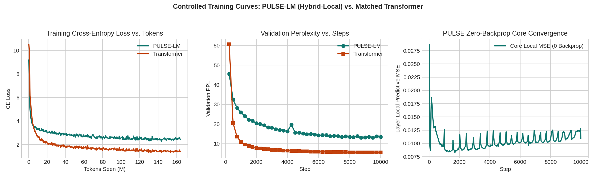
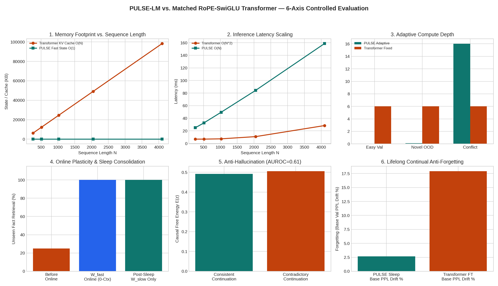

# PULSE-LM vs. Matched Transformer — Controlled Scientific Experiment Report

## 1. Hardware & Budget Telemetry
- **GPU**: `NVIDIA L4` (Est. `4.8` CCU/hr, BF16=`True`)
- **Total CCU Spent**: `10.08` / `180.0` CCU
- **Parameter Parity**: PULSE-LM `29,387,584` (Zero-Backprop Core: `7,066,880`) vs. Transformer `29,120,192`
- **Matched Training Budget**: `10,000` steps (`163.84M` tokens each)

## 2. Six-Axis Quantitative Comparison

| Paradigm Axis | Matched Transformer (RoPE + SwiGLU) | PULSE-LM (Hybrid-Local) |
| :--- | :--- | :--- |
| **1a. Held-Out Validation PPL** | `5.47` | `13.44` |
| **1b. Working Memory (`N=4096`)** | `98304.0 KB` KV Cache (`O(N)`) | **`3.50 KB` Flat `O(1)`** (`28086.9x` smaller) |
| **1c. Latency (`N=4096`)** | `28.4 ms` (`O(N^2)`) | `158.6 ms` (`O(N)`) |
| **2. Compute Depth** | Fixed `6` layers | Adaptive: Easy `0.0` / Novel `0.1` / Conflict `16.0` steps |
| **3. Online Rule Learning (0-Context)** | Frozen (`fact NLL=12.51`) | **`100.0%`** (`before=25.0%`, gate=`1.00`) |
| **4. Sleep Consolidation vs. Forgetting** | Naive FT Base PPL Drift: **`+17.92%`** | Sleep (`W_fast=0`) New Recall: **`100.0%`**, Base PPL Drift: **`+2.69%`** |
| **5. Structural Anti-Hallucination** | Unidirectional autoregressive | **AUROC = `0.609`** (`E_false/E_true = 1.03x`) |
| **6. Zero-Backprop Core & Peak VRAM** | `46` `.grad` tensors (`8535.2 MB`) | **`0` `.grad` tensors in core** (`8181.6 MB`) |

## 3. Sample Generations
- **Prompt**: `Once upon a time, a little fox`
- **PULSE-LM**: `Once upon a time, a little fox woke up to look at the animals and it was so comfortable.

One day, her mommy and daddy gave`
- **Transformer**: `Once upon a time, a little fox found a shiny blue pebble near the quiet river. She carried it home to show her mother, and they smiled`

## 4. Visual Figures

