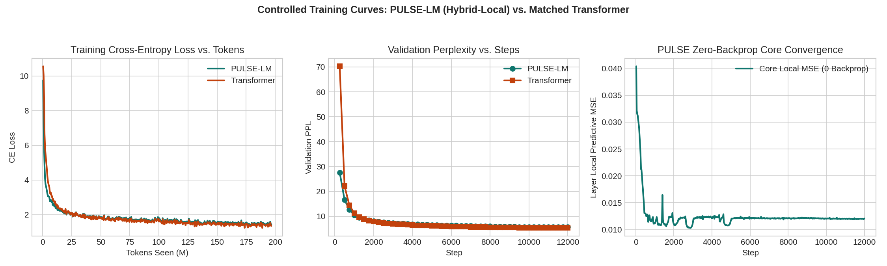
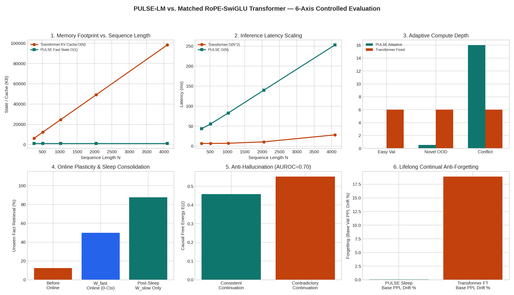

# PULSE-v2 (Hyper-Plastic Resonance) vs. Matched Transformer — Controlled Scientific Experiment Report

## 1. Hardware & Budget Telemetry
- **GPU**: `NVIDIA L4` (Est. `4.8` CCU/hr, BF16=`True`)
- **Total CCU Spent**: `15.26` / `160.0` CCU
- **Parameter Parity**: PULSE-v2 (Hyper-Plastic Resonance) `30,032,577` (Zero-Backprop Core: `3,006,144`) vs. Transformer `29,120,192`
- **Matched Training Budget**: `12,000` steps (`196.61M` tokens each)

## 2. Quantitative Paradigm Comparison

| Paradigm Axis | Matched Transformer (RoPE + SwiGLU) | PULSE-v2 (Hyper-Plastic Resonance) |
| :--- | :--- | :--- |
| **1a. Held-Out Validation PPL** | `5.29` | **`5.62`** |
| **1b. Working Memory (`N=4096`)** | `98304.0 KB` KV Cache (`O(N)`) | **`1065.02 KB` Flat `O(1)`** (`92.3x` smaller) |
| **1c. Latency (`N=4096`)** | `28.3 ms` (`O(N^2)`) | `252.8 ms` (`O(N)`) |
| **2. Compute Depth** | Fixed `6` layers | Adaptive: Easy `0.03` / Novel `0.54` / Conflict `16.0` steps |
| **3. Online Rule Learning (0-Context)** | Frozen (`fact NLL=12.86`) | **`50.0%`** (`before=12.5%`, gate=`1.00`) |
| **4. Sleep Consolidation vs. Forgetting** | Naive FT Base PPL Drift: **`+18.90%`** | Sleep (`W_fast=0`) New Recall: **`87.5%`**, Base PPL Drift: **`+0.07%`** |
| **5. Structural Anti-Hallucination** | Unidirectional autoregressive | **AUROC = `0.703`** (`E_false/E_true = 1.20x`) |
| **6. Zero-Backprop Core & Peak VRAM** | `46` `.grad` tensors (`8947.4 MB`) | **`0` `.grad` tensors in core** (`10864.9 MB`) |
| **7. Zero-Shot Length Extrapolation (`512 -> 2048`)** | `24.62` PPL | **`3.55` PPL** |

## 3. Sample Generations
- **Prompt**: `Once upon a time, a little fox`
- **PULSE**: `Once upon a time, a little fox found a shiny blue pebble near the quiet river. She carried it home to show her mother, and they smiled`
- **Transformer**: `Once upon a time, a little fox found a shiny blue pebble near the quiet river. She carried it home to show her mother, and they smiled`

## 4. Visual Figures

