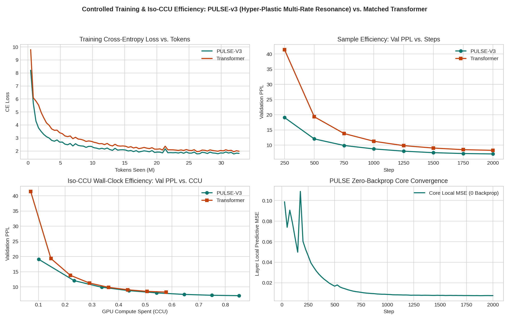
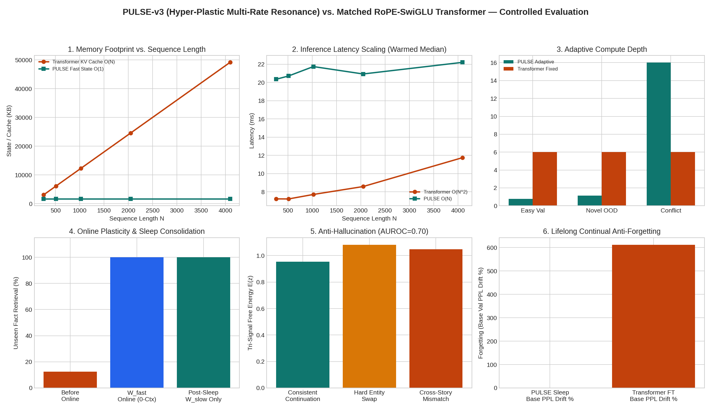

# PULSE-v3 (Hyper-Plastic Multi-Rate Resonance) vs. Matched Transformer — Controlled Scientific Experiment Report

## 1. Hardware & Budget Telemetry
- **GPU**: `NVIDIA L4` (Est. `4.8` CCU/hr, BF16=`True`, Optimizer=`adamw`, Symmetric Compile=`True`)
- **Total CCU Spent**: `1.59` / `12.0` CCU (PULSE=`0.851` CCU, Transformer=`0.579` CCU)
- **Parameter Parity**: PULSE-v3 (Hyper-Plastic Multi-Rate Resonance) `30,355,537` (Trainable Backprop: `28,904,465`, Zero-Backprop Core: `1,451,072`) vs. Transformer `29,120,192`
- **Matched Training Budget**: `2,000` steps (`32.77M` tokens each, Dataset=`tinystories`)
- **Median Training Step Time**: PULSE `302.3 ms/step` vs. Transformer `212.3 ms/step`
- **Iso-CCU / Iso-Time Efficiency**: PULSE matched Transformer's final Val PPL (`8.29`) at step **`1159`** (`1.73x` sample efficiency) using **`0.505` CCU** vs. Transformer's `0.579` CCU (**`1.15x` Iso-CCU compute efficiency**)

## 2. Quantitative Paradigm Comparison

| Paradigm Axis | Matched Transformer (RoPE + SwiGLU) | PULSE-v3 (Hyper-Plastic Multi-Rate Resonance) |
| :--- | :--- | :--- |
| **1a. Held-Out Validation PPL (`N=512`)** | `8.29` | **`7.11`** |
| **1b. Working Memory (`N=4096`)** | `49152.0 KB` KV Cache (`O(N)`) | **`1646.52 KB` Flat `O(1)`** (`29.9x` smaller) |
| **1c. Warmed Latency (`N=4096`)** | `11.8 ms` (`O(N^2)`) | **`22.2 ms`** (`O(N)`) |
| **2. Compute Depth** | Fixed `6` layers | Adaptive: Easy `0.79` / Novel `1.13` / Conflict `16.0` steps |
| **3. Online Rule Learning (0-Context)** | Frozen (`fact NLL=12.86`) | **`100.0%`** (`before=12.5%`, LM Top-1=`100.0%`, base drift=`+0.00%`) |
| **4. Sleep Consolidation vs. Forgetting** | Naive FT Base PPL Drift: **`+611.76%`** | Sleep (`W_fast=0`) New Recall: **`100.0%`**, Base PPL Drift: **`+0.01%`** |
| **5. Structural Anti-Hallucination** | Unidirectional autoregressive | **Cross-Story AUROC = `0.703`** (`1.10x`), **Hard Entity-Swap AUROC = `0.750`** |
| **6. Zero-Backprop Core & Peak VRAM** | `46` `.grad` tensors (`10145.6 MB`) | **`0` `.grad` tensors in core** (`10802.0 MB`) |
| **7. Zero-Shot Length Extrapolation (`512 -> 2048`, 8 non-overlap windows, non-rep=`True`)** | `9.04` PPL (Tail `>512`: `10.16`) | **`4.63` PPL** (Tail `>512`: **`4.49`**) |

## 3. Sample Generations (Unseen Held-Out Prompt)
- **Prompt**: `One rainy morning, a small silver turtle climbed onto the warm mossy stone and saw`
- **PULSE**: `One rainy morning, a small silver turtle climbed onto the warm mossy stone and saw a little bird in a tree. The bird was singing a sweet song. The turtle was very happy and said, "Thank you, bird! You're so`
- **Transformer**: `One rainy morning, a small silver turtle climbed onto the warm mossy stone and saw a beautiful rainbow. He wanted to play with it, but he was too small to reach it. So he decided to climb the large tree and see what was`

## 4. Visual Figures

