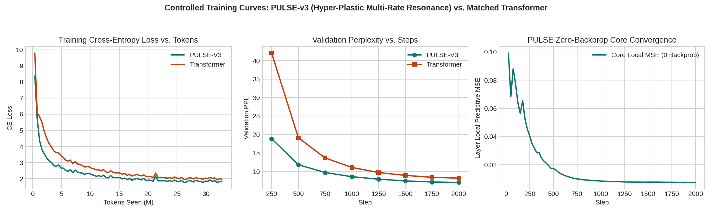
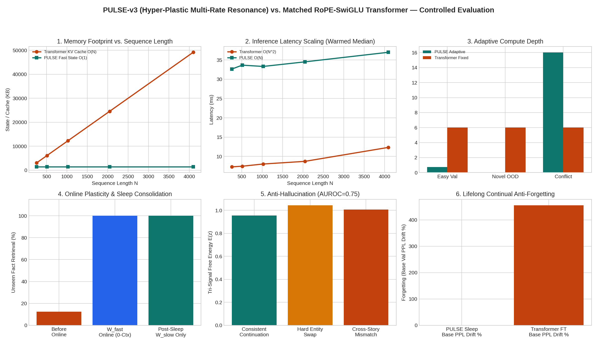

# PULSE-v3 (Hyper-Plastic Multi-Rate Resonance) vs. Matched Transformer — Controlled Scientific Experiment Report

## 1. Hardware & Budget Telemetry
- **GPU**: `NVIDIA L4` (Est. `4.8` CCU/hr, BF16=`True`, Optimizer=`adamw`)
- **Total CCU Spent**: `2.46` / `12.0` CCU
- **Parameter Parity**: PULSE-v3 (Hyper-Plastic Multi-Rate Resonance) `30,398,593` (Trainable Backprop: `28,947,521`, Zero-Backprop Core: `1,451,072`) vs. Transformer `29,120,192`
- **Matched Training Budget**: `2,000` steps (`32.77M` tokens each, Dataset=`tinystories`)
- **Median Training Step Time**: PULSE `644.9 ms/step` vs. Transformer `253.4 ms/step`

## 2. Quantitative Paradigm Comparison

| Paradigm Axis | Matched Transformer (RoPE + SwiGLU) | PULSE-v3 (Hyper-Plastic Multi-Rate Resonance) |
| :--- | :--- | :--- |
| **1a. Held-Out Validation PPL (`N=512`)** | `8.20` | **`7.03`** |
| **1b. Working Memory (`N=4096`)** | `49152.0 KB` KV Cache (`O(N)`) | **`1409.02 KB` Flat `O(1)`** (`34.9x` smaller) |
| **1c. Warmed Latency (`N=4096`)** | `12.3 ms` (`O(N^2)`) | **`37.0 ms`** (`O(N)`) |
| **2. Compute Depth** | Fixed `6` layers | Adaptive: Easy `0.75` / Novel `0.00` / Conflict `16.0` steps |
| **3. Online Rule Learning (0-Context)** | Frozen (`fact NLL=12.74`) | **`100.0%`** (`before=12.5%`, LM Top-1=`100.0%`, base drift=`+4.07%`) |
| **4. Sleep Consolidation vs. Forgetting** | Naive FT Base PPL Drift: **`+455.42%`** | Sleep (`W_fast=0`) New Recall: **`100.0%`**, Base PPL Drift: **`+0.00%`** |
| **5. Structural Anti-Hallucination** | Unidirectional autoregressive | **Cross-Story AUROC = `0.750`** (`1.05x`), **Hard Entity-Swap AUROC = `0.730`** |
| **6. Zero-Backprop Core & Peak VRAM** | `46` `.grad` tensors (`9785.6 MB`) | **`0` `.grad` tensors in core** (`11251.4 MB`) |
| **7. Zero-Shot Length Extrapolation (`512 -> 2048`, 8 non-overlap windows, non-rep=`True`)** | `7.89` PPL (Tail `>512`: `8.48`) | **`4.62` PPL** (Tail `>512`: **`4.47`**) |

## 3. Sample Generations (Unseen Held-Out Prompt)
- **Prompt**: `One rainy morning, a small silver turtle climbed onto the warm mossy stone and saw`
- **PULSE**: `One rainy morning, a small silver turtle climbed onto the warm mossy stone and saw a little bird in a tree. The bird was singing a sweet song. The turtle was so happy and said, "Hello, little bird! You are so`
- **Transformer**: `One rainy morning, a small silver turtle climbed onto the warm mossy stone and saw it was not a toy. He was very sad and he wanted to help the turtle.

But then, a small bird saw the turtle and got scared`

## 4. Visual Figures

