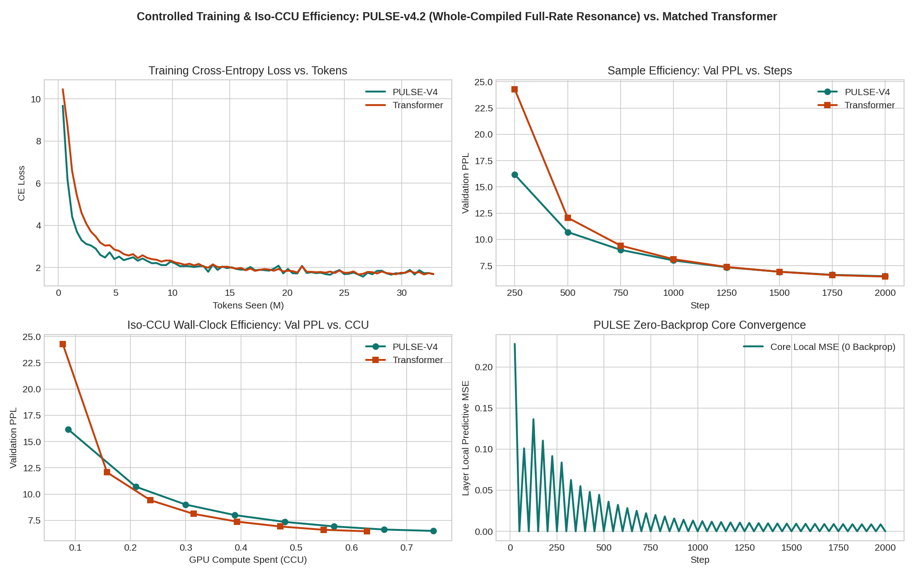
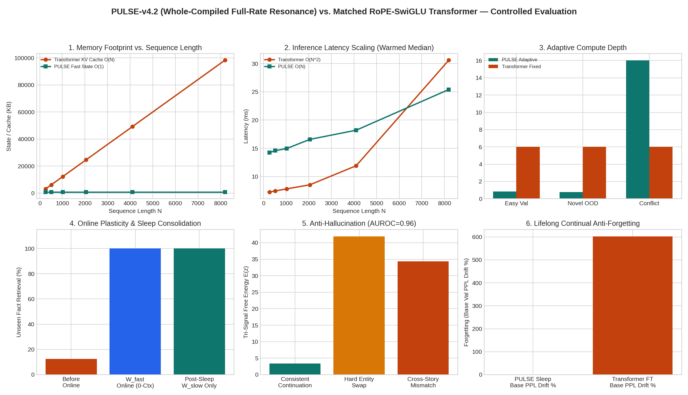

# PULSE-v4.2 (Whole-Compiled Full-Rate Resonance) vs. Matched Transformer — Controlled Scientific Experiment Report

## 1. Hardware & Budget Telemetry
- **GPU**: `NVIDIA L4` (Est. `4.8` CCU/hr, BF16=`True`, Optimizer=`muon`, Symmetric Compile=`True`)
- **Total CCU Spent**: `1.57` / `12.0` CCU (PULSE=`0.749` CCU, Transformer=`0.628` CCU)
- **Parameter Parity**: PULSE-v4.2 (Whole-Compiled Full-Rate Resonance) `30,437,409` (Trainable Backprop: `28,986,337`, Zero-Backprop Core: `1,451,072`) vs. Transformer `29,120,192`
- **Matched Training Budget**: `2,000` steps (`32.77M` tokens each, Dataset=`tinystories`)
- **Median Training Step Time**: PULSE `262.1 ms/step` vs. Transformer `231.7 ms/step`

## 2. Quantitative Paradigm Comparison

| Paradigm Axis | Matched Transformer (RoPE + SwiGLU) | PULSE-v4.2 (Whole-Compiled Full-Rate Resonance) |
| :--- | :--- | :--- |
| **1a. Held-Out Validation PPL (`N=512`)** | `6.46` | **`6.50`** |
| **1b. Working Memory (`N=8192`)** | `98304.0 KB` KV Cache (`O(N)`) | **`691.02 KB` Flat `O(1)`** (`142.3x` smaller) |
| **1c. Warmed Latency (`N=8192`)** | `30.6 ms` (`O(N^2)`) | **`25.4 ms`** (`O(N)`) |
| **2. Compute Depth** | Fixed `6` layers | Adaptive: Easy `0.83` / Novel `0.77` / Conflict `16.0` steps |
| **3. Online Rule Learning (0-Context)** | Frozen (`fact NLL=12.51`) | **`100.0%`** (`before=12.5%`, LM Top-1=`87.5%`, base drift=`+0.00%`) |
| **4. Sleep Consolidation vs. Forgetting** | Naive FT Base PPL Drift: **`+602.14%`** | Sleep (`W_fast=0`) New Recall: **`100.0%`**, Base PPL Drift: **`+0.08%`** |
| **5. Structural Anti-Hallucination** | Unidirectional autoregressive | **Cross-Story AUROC = `0.963`** (`10.23x`), **Hard Entity-Swap AUROC = `0.976`** |
| **6. Zero-Backprop Core & Peak VRAM** | `46` `.grad` tensors (`9061.3 MB`) | **`0` `.grad` tensors in core** (`9485.2 MB`) |
| **7. Zero-Shot Length Extrapolation (`512 -> 2048`, 8 non-overlap windows, non-rep=`True`)** | `5.51` PPL (Tail `>512`: `5.85`) | **`4.24` PPL** (Tail `>512`: **`4.11`**) |

## 3. Sample Generations (Unseen Held-Out Prompt)
- **Prompt**: `One rainy morning, a small silver turtle climbed onto the warm mossy stone and saw`
- **PULSE**: `One rainy morning, a small silver turtle climbed onto the warm mossy stone and saw a little bird in a tree. The bird was singing a sweet song and the turtle was very excited. They both wanted to play a game of hide and seek`
- **Transformer**: `One rainy morning, a small silver turtle climbed onto the warm mossy stone and saw a little girl. She wanted to play with the stone, but the turtle said no. The little girl felt sad and started to cry.

Suddenly,`

## 4. Visual Figures

