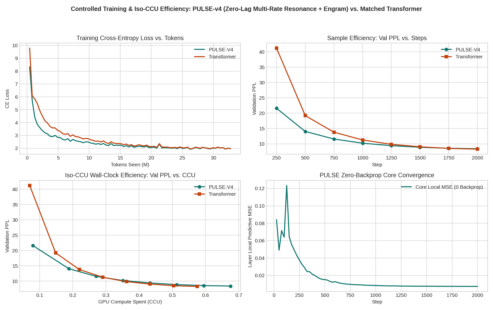
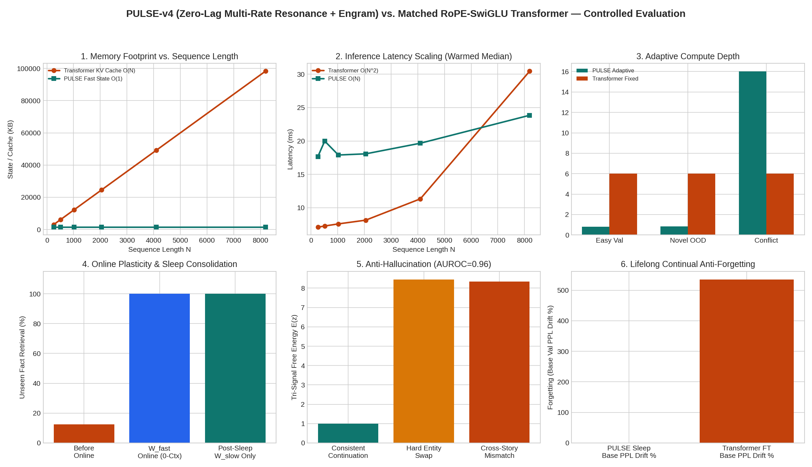

# PULSE-v4 (Zero-Lag Multi-Rate Resonance + Engram) vs. Matched Transformer — Controlled Scientific Experiment Report

## 1. Hardware & Budget Telemetry
- **GPU**: `NVIDIA L4` (Est. `4.8` CCU/hr, BF16=`True`, Optimizer=`adamw`, Symmetric Compile=`True`)
- **Total CCU Spent**: `1.44` / `12.0` CCU (PULSE=`0.676` CCU, Transformer=`0.575` CCU)
- **Parameter Parity**: PULSE-v4 (Zero-Lag Multi-Rate Resonance + Engram) `30,392,977` (Trainable Backprop: `28,941,905`, Zero-Backprop Core: `1,451,072`) vs. Transformer `29,120,192`
- **Matched Training Budget**: `2,000` steps (`32.77M` tokens each, Dataset=`tinystories`)
- **Median Training Step Time**: PULSE `238.3 ms/step` vs. Transformer `210.1 ms/step`

## 2. Quantitative Paradigm Comparison

| Paradigm Axis | Matched Transformer (RoPE + SwiGLU) | PULSE-v4 (Zero-Lag Multi-Rate Resonance + Engram) |
| :--- | :--- | :--- |
| **1a. Held-Out Validation PPL (`N=512`)** | `8.27` | **`8.39`** |
| **1b. Working Memory (`N=8192`)** | `98304.0 KB` KV Cache (`O(N)`) | **`1449.03 KB` Flat `O(1)`** (`67.8x` smaller) |
| **1c. Warmed Latency (`N=8192`)** | `30.4 ms` (`O(N^2)`) | **`23.8 ms`** (`O(N)`) |
| **2. Compute Depth** | Fixed `6` layers | Adaptive: Easy `0.80` / Novel `0.84` / Conflict `16.0` steps |
| **3. Online Rule Learning (0-Context)** | Frozen (`fact NLL=13.81`) | **`100.0%`** (`before=12.5%`, LM Top-1=`100.0%`, base drift=`+0.00%`) |
| **4. Sleep Consolidation vs. Forgetting** | Naive FT Base PPL Drift: **`+534.81%`** | Sleep (`W_fast=0`) New Recall: **`100.0%`**, Base PPL Drift: **`+0.03%`** |
| **5. Structural Anti-Hallucination** | Unidirectional autoregressive | **Cross-Story AUROC = `0.963`** (`8.31x`), **Hard Entity-Swap AUROC = `0.951`** |
| **6. Zero-Backprop Core & Peak VRAM** | `46` `.grad` tensors (`8407.8 MB`) | **`0` `.grad` tensors in core** (`8306.2 MB`) |
| **7. Zero-Shot Length Extrapolation (`512 -> 2048`, 8 non-overlap windows, non-rep=`True`)** | `10.67` PPL (Tail `>512`: `12.65`) | **`5.56` PPL** (Tail `>512`: **`5.32`**) |

## 3. Sample Generations (Unseen Held-Out Prompt)
- **Prompt**: `One rainy morning, a small silver turtle climbed onto the warm mossy stone and saw`
- **PULSE**: `One rainy morning, a small silver turtle climbed onto the warm mossy stone and saw a little bird. She felt sad for the bird and wanted to help. She flew down and tried to help the bird. The bird flew away and landed on`
- **Transformer**: `One rainy morning, a small silver turtle climbed onto the warm mossy stone and saw a little girl. She wanted to play with the fish, but the turtle was too far away. She grabbed the stone and ran away.

The little`

## 4. Visual Figures

