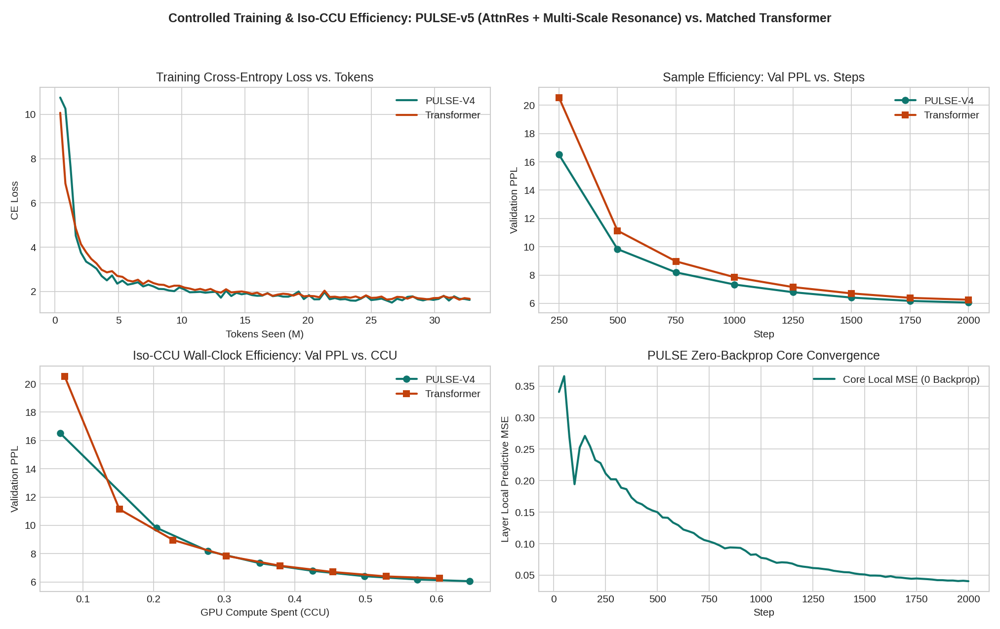
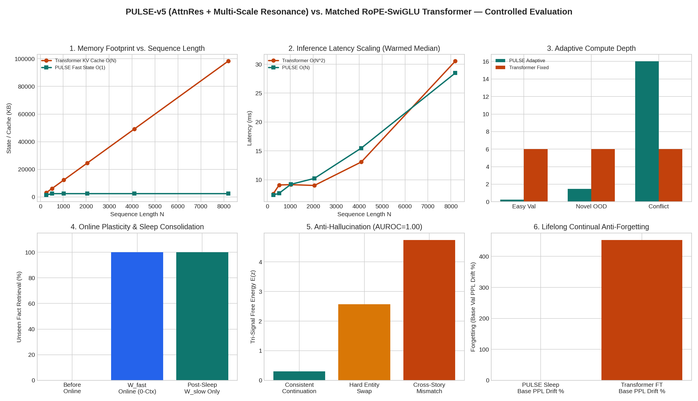

# PULSE-v5 (AttnRes + Multi-Scale Resonance) vs. Matched Transformer — Controlled Scientific Experiment Report

## 1. Hardware & Budget Telemetry
- **GPU**: `NVIDIA L4` (Est. `4.8` CCU/hr, BF16=`True`, Optimizer=`muon`, Symmetric Compile=`True`)
- **Total CCU Spent**: `1.59` / `12.0` CCU (PULSE=`0.647` CCU, Transformer=`0.604` CCU)
- **Parameter Parity**: PULSE-v5 (AttnRes + Multi-Scale Resonance) `30,449,642` (Trainable Backprop: `28,867,498`, Zero-Backprop Core: `1,582,144`) vs. Transformer `29,120,192`
- **Matched Training Budget**: `2,000` steps (`32.77M` tokens each, Dataset=`tinystories`)
- **Median Training Step Time**: PULSE `213.6 ms/step` vs. Transformer `222.5 ms/step`
- **Iso-CCU / Iso-Time Efficiency**: PULSE matched Transformer's final Val PPL (`6.25`) at step **`1664`** (`1.20x` sample efficiency) using **`0.548` CCU** vs. Transformer's `0.604` CCU (**`1.10x` Iso-CCU compute efficiency**)

## 2. Quantitative Paradigm Comparison

| Paradigm Axis | Matched Transformer (RoPE + SwiGLU) | PULSE-v5 (AttnRes + Multi-Scale Resonance) |
| :--- | :--- | :--- |
| **1a. Held-Out Validation PPL (`N=512`)** | `6.25` | **`6.05`** |
| **1b. Working Memory (`N=8192`)** | `98304.0 KB` KV Cache (`O(N)`) | **`2419.00 KB` Flat `O(1)`** (`40.6x` smaller) |
| **1c. Warmed Latency (`N=8192`)** | `30.5 ms` (`O(N^2)`) | **`28.5 ms`** (`O(N)`) |
| **2. Compute Depth** | Fixed `6` layers | Adaptive: Easy `0.23` / Novel `1.48` / Conflict `16.0` steps |
| **3. Online Rule Learning (0-Context)** | Frozen (`fact NLL=13.38`) | **`100.0%`** (`before=0.0%`, LM Top-1=`100.0%`, base drift=`+0.00%`) |
| **4. Sleep Consolidation vs. Forgetting** | Naive FT Base PPL Drift: **`+452.78%`** | Sleep (`W_fast=0`) New Recall: **`100.0%`**, Base PPL Drift: **`+0.00%`** |
| **5. Structural Anti-Hallucination** | Unidirectional autoregressive | **Cross-Story AUROC = `0.995`** (`15.64x`), **Hard Entity-Swap AUROC = `0.993`** |
| **6. Zero-Backprop Core & Peak VRAM** | `46` `.grad` tensors (`8509.4 MB`) | **`0` `.grad` tensors in core** (`6512.7 MB`) |
| **7. Zero-Shot Length Extrapolation (`512 -> 2048`, 8 non-overlap windows, non-rep=`True`)** | `8.59` PPL (Tail `>512`: `10.55`) | **`3.91` PPL** (Tail `>512`: **`3.81`**) |

## 3. Sample Generations (Unseen Held-Out Prompt)
- **Prompt**: `One rainy morning, a small silver turtle climbed onto the warm mossy stone and saw`
- **PULSE**: `One rainy morning, a small silver turtle climbed onto the warm mossy stone and saw a little bird in a tree. The bird was singing a sweet song. The turtle liked the song and wanted to find the bird.

The turtle jumped`
- **Transformer**: `One rainy morning, a small silver turtle climbed onto the warm mossy stone and saw a beautiful garden. He wanted to play in the garden, so he decided to climb it. He climbed and climbed until he reached the top.

The`

## 4. Visual Figures

