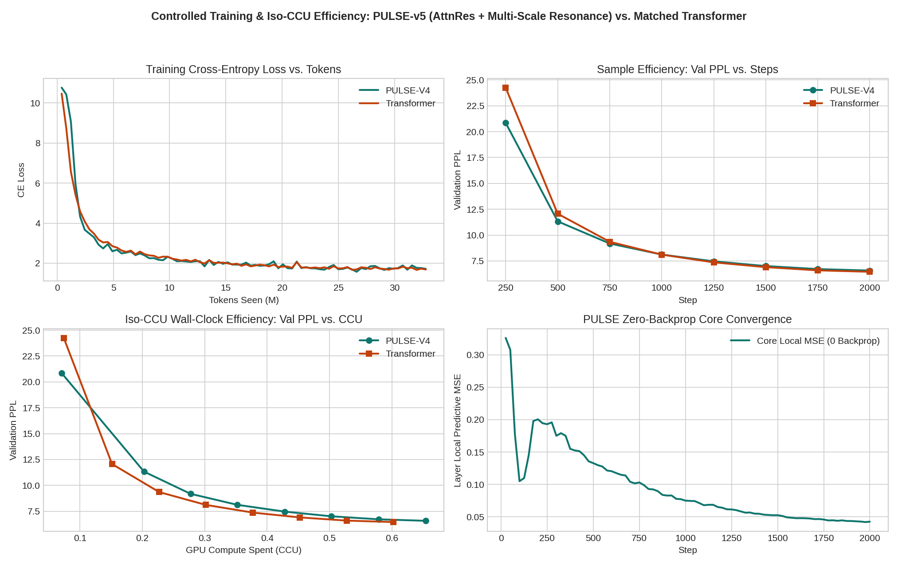
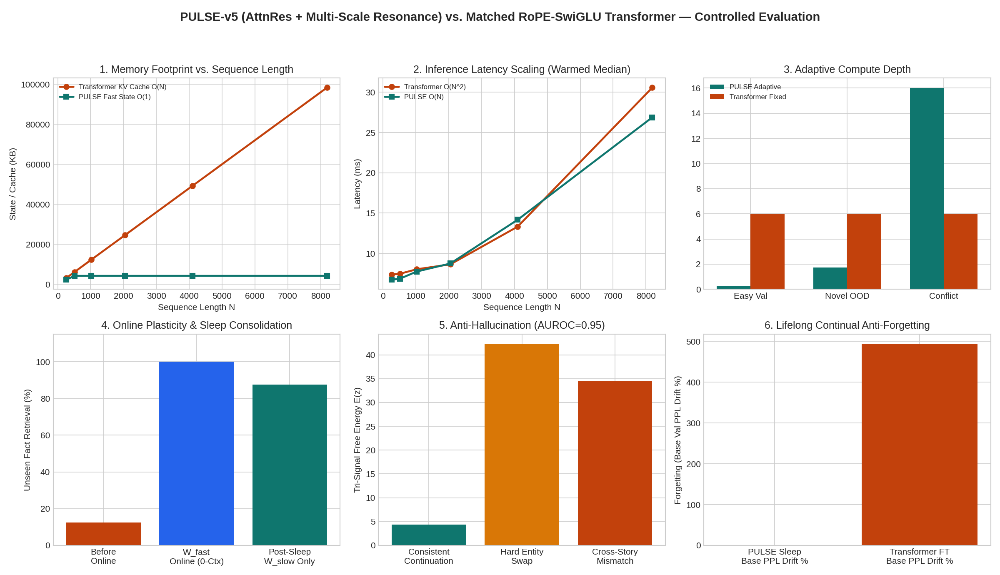

# PULSE-v5 (AttnRes + Multi-Scale Resonance) vs. Matched Transformer — Controlled Scientific Experiment Report

## 1. Hardware & Budget Telemetry
- **GPU**: `NVIDIA L4` (Est. `4.8` CCU/hr, BF16=`True`, Optimizer=`muon`, Symmetric Compile=`True`)
- **Total CCU Spent**: `1.59` / `12.0` CCU (PULSE=`0.654` CCU, Transformer=`0.603` CCU)
- **Parameter Parity**: PULSE-v5 (AttnRes + Multi-Scale Resonance) `30,535,146` (Trainable Backprop: `28,953,002`, Zero-Backprop Core: `1,582,144`) vs. Transformer `29,120,192`
- **Matched Training Budget**: `2,000` steps (`32.77M` tokens each, Dataset=`tinystories`)
- **Median Training Step Time**: PULSE `218.6 ms/step` vs. Transformer `222.1 ms/step`

## 2. Quantitative Paradigm Comparison

| Paradigm Axis | Matched Transformer (RoPE + SwiGLU) | PULSE-v5 (AttnRes + Multi-Scale Resonance) |
| :--- | :--- | :--- |
| **1a. Held-Out Validation PPL (`N=512`)** | `6.45` | **`6.57`** |
| **1b. Working Memory (`N=8192`)** | `98304.0 KB` KV Cache (`O(N)`) | **`4175.00 KB` Flat `O(1)`** (`23.5x` smaller) |
| **1c. Warmed Latency (`N=8192`)** | `30.6 ms` (`O(N^2)`) | **`26.9 ms`** (`O(N)`) |
| **2. Compute Depth** | Fixed `6` layers | Adaptive: Easy `0.23` / Novel `1.73` / Conflict `16.0` steps |
| **3. Online Rule Learning (0-Context)** | Frozen (`fact NLL=12.51`) | **`100.0%`** (`before=12.5%`, LM Top-1=`50.0%`, base drift=`+2.77%`) |
| **4. Sleep Consolidation vs. Forgetting** | Naive FT Base PPL Drift: **`+492.99%`** | Sleep (`W_fast=0`) New Recall: **`87.5%`**, Base PPL Drift: **`+0.00%`** |
| **5. Structural Anti-Hallucination** | Unidirectional autoregressive | **Cross-Story AUROC = `0.952`** (`7.89x`), **Hard Entity-Swap AUROC = `0.964`** |
| **6. Zero-Backprop Core & Peak VRAM** | `46` `.grad` tensors (`8892.0 MB`) | **`0` `.grad` tensors in core** (`7122.3 MB`) |
| **7. Zero-Shot Length Extrapolation (`512 -> 2048`, 8 non-overlap windows, non-rep=`True`)** | `5.50` PPL (Tail `>512`: `5.83`) | **`4.28` PPL** (Tail `>512`: **`4.16`**) |

## 3. Sample Generations (Unseen Held-Out Prompt)
- **Prompt**: `One rainy morning, a small silver turtle climbed onto the warm mossy stone and saw`
- **PULSE**: `One rainy morning, a small silver turtle climbed onto the warm mossy stone and saw a little bird. She was very excited to see the turtle.

The turtle was very polite and said, "Hello little bird! Will you be my`
- **Transformer**: `One rainy morning, a small silver turtle climbed onto the warm mossy stone and saw a little girl. The turtle said, "Hi, little girl! I am so happy to meet you." The little girl smiled and said, "Hi!"`

## 4. Visual Figures

