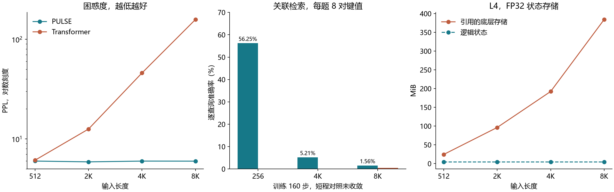

# PULSE-v5.3 压力测试审计

本轮在 NVIDIA L4 上完整执行，实际用时 650.33 秒，约 10 分 50 秒。PULSE 与 Transformer 都从原有 2,000 步、约 3,277 万训练词元的检查点载入。PULSE 总参数为 30,449,642，Transformer 为 29,120,192。按旧脚本的 4.8 CCU/小时估算，本轮约消耗 0.87 CCU。资源面板的实际扣费尚未核实。

本轮完成检查点干预、困惑度评测、受控续写检测、在线编辑与睡眠、口令检索，以及 160 步专门训练后的关联检索。100M 以上参数、每种模型至少 10 亿词元的 FineWeb-Edu 训练尚未执行。

**结论范围**

PULSE 主干在本轮 TinyStories 样本上保持了较低困惑度，并在直接外推到 4K、8K 时保持稳定。关闭预测编码核心与关闭快权重都没有改变基础困惑度。在线编辑确实依赖这些通路。语义一致性检测与远距离精确检索仍暴露明显弱点。

**语言建模消融**

每个长度评测 24 个不重叠窗口。四种长度使用相同的长窗口位置，另存共同末尾 128 个目标词元的评分。下表为各长度全部目标的困惑度，越低越好。

| 输入长度 | 完整 PULSE | 关闭快权重 | 关闭预测编码核心 | Transformer |
| --- | ---: | ---: | ---: | ---: |
| 512 | 5.9893 | 5.9893 | 5.9893 | 6.1072 |
| 2,048 | 5.8777 | 5.8777 | 5.8777 | 12.5558 |
| 4,096 | 5.9851 | 5.9851 | 5.9851 | 45.9513 |
| 8,192 | 5.9774 | 5.9774 | 5.9774 | 158.3009 |

两个消融的配对平均负对数似然变化均为 0，记录的区间也为 [0, 0]。该结果来自同一份已训练权重的推理干预。正式从头重训消融仍待执行。源码同时显示，基础交叉熵训练直接优化主干，普通预训练没有调用 RLS 事实写入。

源码调度还有一处错位。GPU 核心更新发生在步计数对 8 取余为 7 时，但调用者只在偶数步允许更新评论器，只在对 8 取余为 0 时允许观测先验。按当前调用顺序，这两个条件都错过核心更新步。后续规模脚本保留了原调度以复现已发布版本，并记录该选择。修正调度后的模型表现还需单独验证。

512 长度下，Transformer 相对 PULSE 的配对平均负对数似然差为 0.01949，窗口重采样的 95% 区间为 [0.00166, 0.03805]。PULSE 困惑度约低 1.93%。这个样本上的优势可以保留，预测编码核与快权重在此次基础评测中的增益为 0。

Transformer 使用原有短上下文训练的 RoPE 配置。长长度结果反映该检查点直接外推的表现。加入长上下文训练、位置缩放或局部注意力对照后的结论还需实验。

共同末尾 128 个目标的 PULSE 困惑度在 2K、4K、8K 分别为 5.9235081、5.9235085、5.9235089。新增更远上下文在该指标上产生的变化极小。稳定的长文本困惑度与精确记住远处键值需要分别评测。

**公平评分与语义一致性**

两种模型都执行同一份负 PMI 计算，以及原评分器的 A/B 两通道公式。负 PMI 使用条件负对数似然减去无条件负对数似然。

| 测试 | 样本对数 | PULSE 负 PMI AUROC | Transformer 负 PMI AUROC | PULSE A/B AUROC | Transformer A/B AUROC |
| --- | ---: | ---: | ---: | ---: | ---: |
| 打乱不同片段的续写 | 24 | 0.9948 | 1.0000 | 1.0000 | 1.0000 |
| 随机位置替换一个词元 | 23 | 0.6805 | 0.6597 | 0.9319 | 0.8866 |
| 控制句式中的人名替换 | 24 | 0.4479 | 0.4618 | 0.4323 | 0.4479 |

随机词元替换任务中，PULSE A/B 相对 Transformer 的 AUROC 差为 +0.0454，配对重采样区间为 [-0.0077, +0.1002]。当前样本量不足以确认这个差距。

完整 PULSE 评分器含预测编码能量项。移除这些项后，打乱续写和人名替换任务的 AUROC 变化均为 0。随机词元替换的差为 -0.00189，区间为 [-0.01134, +0.00756]。

在人名替换任务上，两种模型的排序表现都接近随机。此前接近 0.99 的检测指标主要来自较容易的文本错配与词元异常任务。当前结果尚未建立对语义错误的可靠检测能力。

**在线编辑与睡眠**

任务由两批各 12 条随机键值关联组成，测试使用曾教过的相同提示。LoRA 两个对照都使用 54,784 个适配器参数、相同优化步数与回放数据。第二批训练回放第一批事实。

| 方法 | 第一批保留 | 第二批召回 | 总召回 | 基础困惑度变化 |
| --- | ---: | ---: | ---: | ---: |
| PULSE RLS | 11/12 | 8/12 | 19/24，79.17% | 6.498 → 6.498 |
| PULSE LoRA + Replay | 12/12 | 4/12 | 16/24，66.67% | 6.498 → 15.325 |
| Transformer LoRA + Replay | 6/12 | 3/12 | 9/24，37.50% | 6.804 → 13.037 |

PULSE RLS 的优势体现在本轮测试的召回与基础困惑度漂移。LoRA 的固定学习率为 0.002，秩为 8，每批训练 48 步。这些超参数尚未进行开发集搜索，结果代表当前配置。

PULSE 睡眠后快权重范数为 0，公开语言模型调用仍召回 19/24 条。将该调用的快权重开关关闭后，召回变为 0/24。源码中这个开关也控制已经固化的旁路访问，命名没有区分快慢旁路。睡眠后保留了记忆，但记忆访问仍依赖该旁路开关。

随机关联、相同提示、单个目标词元构成此次任务边界。提示改写、干扰事实、大容量写入及生成完整多词答案尚待验证。19/24 的结果需要取代这轮测试中的“100% 召回”表述。

**大海捞针与多查询关联检索**

未进行专门训练时，两种模型在 512、4K、8K 的五位口令检索上都为 0 命中。每个长度各有三个插入位置，每个位置 24 题，合计每种模型 216 题。两个模型在短上下文上也没有完成该任务，零命中结果不足以定位其记忆容量边界。

下面是在长度 256、每题 8 对键值上训练 160 步后的 MQAR 变体结果。

| 测试长度 | 每题键值对数 | PULSE | Transformer |
| --- | ---: | ---: | ---: |
| 256 | 8 | 108/192，56.25% | 0/192，0.00% |
| 4,096 | 8 | 10/192，5.21% | 0/192，0.00% |
| 8,192 | 8 | 3/192，1.56% | 1/192，0.52% |
| 256 | 32 | 316/768，41.15% | 4/768，0.52% |
| 4,096 | 32 | 13/768，1.69% | 4/768，0.52% |
| 8,192 | 32 | 6/768，0.78% | 4/768，0.52% |

这轮结果显示 PULSE 的短程训练适应较快，远程准确率显著下降。Transformer 连短程对照也未学会，我给出的固定 160 步训练不足以构成收敛后的容量比较。这是本轮评测设计的限制。后续脚本已增加独立开发样本的短程学习曲线，要求双方都达到 95% 短程准确率才标记该对照通过。未达到时，长程数据继续保留为未收敛结果。

该任务是自行实现的 MQAR 变体，正文中的键值对分布在前 75% 位置，查询位于后 25%。它尚未完成与 Zoology 官方生成器逐项一致性验证。

**L4 上复现的内存计数问题**

| 输入长度 | 状态张量逻辑大小 | 被这些张量引用的底层存储 |
| --- | ---: | ---: |
| 512 | 4.47 MiB | 24.25 MiB |
| 2,048 | 4.47 MiB | 96.25 MiB |
| 4,096 | 4.47 MiB | 192.25 MiB |
| 8,192 | 4.47 MiB | 384.25 MiB |

这轮使用 FP32 权重、即时执行路径。窗口切片调用 detach 后仍然共享较大张量的底层存储，释放局部输出也不会释放这些被状态引用的存储。逻辑状态大小恒定，但当前路径实际保留的存储随输入长度增长。该测量没有覆盖编译加 BF16 的独立路径，也没有把整个模型、临时激活和 CUDA 缓存纳入上表。

相同长度下修改未来后缀，两种模型前缀位置的输出变化均为 0。本轮这项检查没有发现未来信息泄漏。原审计脚本还把是否返回状态造成的核函数差异混入了消融最大输出差，后续版本已经分开记录。

**下一阶段的实施与未完成事项**

配套规模训练脚本配置 PULSE 105,308,468 参数，Transformer 104,842,368 参数。PULSE 可反传参数为 102,672,308。两者读取相同顺序的真实 FineWeb-Edu 词元，目标为各自至少 10 亿个预测目标，保留成对检查点和局部优化器状态。

首次运行默认进行 32 步配对吞吐量校准并保存断点。4.8 CCU/小时仅用于暂估，面板显示其他值时可以直接替换。取消 CALIBRATION_ONLY 即可继续已保存的训练。规模阶段暂分配最多 145 CCU，另外预留 15 CCU 给短审计与恢复。预算估算和实际扣费仍可能有差异。

本地已经验证词元计数无重复遗漏、三个种子的微型重训消融以及一次保存恢复后状态连续性。L4 上的 100M 规模吞吐量、显存和完整训练尚未验证。该笔记本未启动，原始任务的规模验证仍处于待执行状态。

**原始结果**

本报告根据以下 Drive 目录中的九个 JSON 文件计算，目录保留逐题结果、逐窗口损失、权重哈希及完成状态。

[审计原始输出](https://drive.google.com/drive/folders/1cJ3SPbk_JiP0af7yJJ1IycI5fw-CV2Zr)

源码包 SHA-256 为 `0c4258fa39670f2c0df7ce48ddcae3039b33068358f4d88fddb41f7ea7e3c6c9`。PULSE 权重 SHA-256 为 `48e129e5e5c6b1d01d11e0465d17ec94d95536eb74af5fdda01646dc6f42b1bd`。Transformer 权重 SHA-256 为 `0945eeef075f69afd08545e8a5c156227e636dc4650f5cfe09d065e7cd226aa4`。
